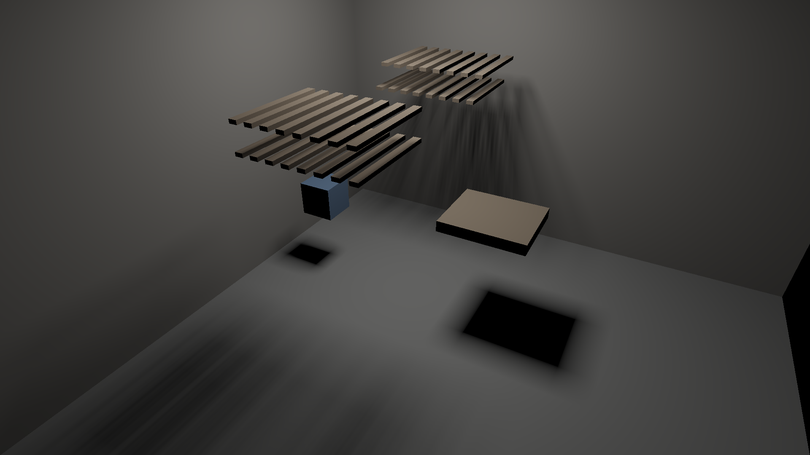
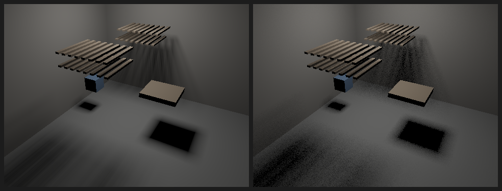

# Continuum

A real-time renderer built on an original paradigm: certified incremental cone
rendering. Every visibility question is asked by a cone that answers in bits,
and cached answers are recomputed only when they could have changed by more
than a chosen, invisible error bound.

Status: research stage. The core bets are being tested in 2D before any GPU work.
See [docs/DESIGN.md](docs/DESIGN.md) for the design and
[docs/results/](docs/results/) for measured results.

## Layout

- `crates/continuum`: the library: direction masks (binary and continuous), the
  error ledger, 3D pyramid cones with exact per-bin rasterization, and a BVH.
- `crates/continuum-gpu`: wgpu compute backend (mask cones in WGSL).
- `experiments/flatland`: 2D experiments that test the core bets (milestone M0).
- `experiments/room3d`: 3D experiments on triangle scenes (milestone M1).
- `docs/`: design document and experiment results.

## Running

```bash
cargo test --release
cargo run --release -p flatland --bin gate1
cargo run --release -p flatland --bin ledger
cargo run --release -p flatland --bin gate4
cargo run --release -p flatland --bin gate5
cargo run --release -p flatland --bin gate6
cargo run --release -p flatland --bin gate6b
cargo run --release -p flatland --bin gate7
cargo run --release -p room3d --bin m1_gate1
cargo run --release -p room3d --bin m1_gate2
cargo run --release -p room3d --bin m1_gate3
cargo run --release -p room3d --bin m1_gate4
cargo run --release -p room3d --bin render
cargo run --release -p room3d --bin m2_gate1
cargo run --release -p room3d --bin render_gpu
cargo run --release -p room3d --bin m2_gate2
cargo run --release -p room3d --bin m2_gate3 -- capture   # once, before kernel changes
cargo run --release -p room3d --bin m2_gate3
cargo run --release -p room3d --bin m2_gate4
```



The same scene rendered on the GPU at 1080p (Apple M4, 189 ms, brute force with
no hierarchy yet; see `docs/results/m2-gpu-render.md`).



First 3D render (direct light only, CPU, 480×360). Left: mask cones,
deterministic and noise-free. Right: 16 jittered light samples per pixel at
about the same cost. Shadows are black because there is no indirect light yet.

Each run prints a results table and writes images to `experiments/flatland/out/`:

- `sheet.png` (gate 1): top row renders, bottom row signed error maps (red too
  dark, blue too bright).
- `ledger_<scenario>.png` (gates 2–3): one row per key frame; columns are the
  lit result, tiles recomputed that frame (orange), the certified error bound,
  and the actual error. `_stress` versions use a deliberately huge ε so the
  bound and error columns have something to show.
- `gate5_<visibility>_<charging>.png` (gate 5): the same four columns for the
  sky scenario at ε = 1%.
- `gate6_bounce.png` (gate 6): the same four columns for one-bounce indirect
  light (attempt 3 charges, ε = 1%).
