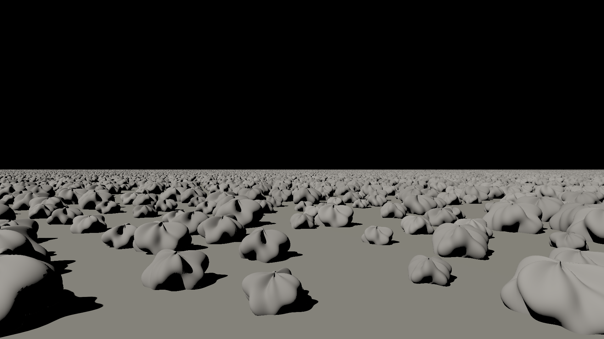
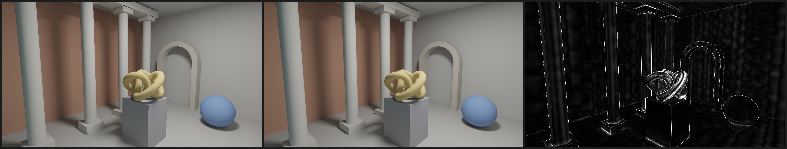

# Continuum

A real-time renderer built on an original paradigm: certified incremental cone
rendering. Every visibility question is asked by a cone that answers in bits,
and cached answers are recomputed only when they could have changed by more
than a chosen, invisible error bound.

Status: experimental; `v0.1.0` is tagged, and later work is on `main`. The
core bets were tested in 2D (M0) and in 3D on the CPU (M1). On the GPU,
Continuum renders:

- a procedural showcase in real time, with moving objects, exact soft shadows
  and one bounce of indirect light (M2–M3);
- a million-boulder field of ten billion triangles through a view-dependent
  lighting cache (M4);
- area, sun, point and spot lights and a sky (M5);
- glTF files with textures (M6);
- objects moving among a million static ones, the cache updated exactly in
  the frame they move, with no stale light (M9 gate 1);
- moving lights through an error ledger, experimental: never stale, but
  with heavy fallback while a light moves (M9 gate 2, failed on that);
- moving objects under a sky, experimental: never stale, but slow, since
  nearly every page re-bakes its sky while objects move (M9 gate 3,
  failed on that);
- one bounce of light in the cache, 1.79% from Cycles with one bounce
  (M10 gate 1);
- metallic-roughness materials with glossy reflections, experimental
  (8.94% from Cycles, M10 gate 2, failed against 6%);
- normal maps, 3.63% from Cycles (M10 gate 5), alpha cutouts, 3.29% (M10
  gate 7), exactly back-to-back double-sided faces (M10 gates 8–9), and
  emission;
- textures box-filtered over each pixel's footprint (M7 gate 2).

Every claim is measured against Blender's Cycles.

- [docs/GUIDE.md](docs/GUIDE.md): using it as a library; API reference with
  `cargo doc --no-deps -p continuum-gpu -p continuum-gltf --open`.
- [docs/DESIGN.md](docs/DESIGN.md): the design, an honest status (§3.6),
  and what to do next (§3.8, "Start here").
- [docs/results/](docs/results/): every measured result.

## Try it: the real-time viewer

```bash
cargo run --release -p viewer
```

Fly through the showcase: a gallery with a colonnade, an arch and a torus-knot
sculpture, lit by one skylight, with a bouncing ball and a spinning cube.

Controls:

- WASD to move, Q/E down and up, Shift to move faster.
- Drag with the left mouse button to look.
- C plays the camera path, P pauses the moving objects.
- V toggles vsync, Esc quits.

The title bar shows the frame rate. `--scene room` opens the M2 test room
instead.

### The million-boulder field

```bash
cargo run --release -p viewer -- --scene field --scale 2
```

This is a 2 km plain with 1,000,000 instanced copies of a 9,800-triangle
boulder: about ten billion triangles in 152 MB of GPU memory. It is lit by a
sun-sized light through a view-dependent lighting cache (M4 gate 8):

- Pages of texels are allocated on the surfaces you look at, coarser with
  distance.
- They are baked with mask cones, at most 20,000 per frame, and kept while
  they stay in view.
- Shading a warm view costs 2–3 ms.

Flags:

- `--boulders N` changes the count.
- `--scale N` renders at 1/N of the window.
- `--no-cache` lights every pixel with its own mask cone every frame, as
  before.
- `--sky` adds a blue-white sky. Frames keep their rate (flights average
  14.8 ms with sun and sky, M5 gate 5), but sky light converges slowly.
  Pages bake their lights first and their sky later, so a view comes within
  5% of its warm image in 120–300 frames, and is warm in 1,200–2,600 at a
  fixed budget (M5 gate 9).

Scenes can have several colored rectangular lights (`Renderer::new` takes a
list). The cache stores light per unit
radiance, so `set_light_radiance` re-colors a light with no bake. Three
lights on the field, a warm sun, a cool fill and an orange lamp, are within
1.2% of Cycles, and flights over them average 14–15 ms (M5 gate 6).

Texels store each light's shadowed share of its unshadowed light, and each
pixel applies its own normal (M5 gate 7). This halves the cache's error
against per-pixel cones.

Point lights with a size and spot lights (glTF's falloff) work too, per
pixel and cached. A night scene lit by both is 1.35% from Cycles (M5
gate 8).

On the fanless M4 Air, flights with several lights hold 13–15 ms while the
machine is cool. After minutes of load the GPU slows, and they take 20 ms or
more (M5 gate 8).

### Your own scenes (glTF)

`continuum_gltf::load` imports glTF 2.0 files (`.gltf`, `.glb`) as instanced
scenes:

- meshes and node instances;
- base color factors and textures, sampled per pixel at the pixel's
  footprint;
- automatic charts for the lighting cache.

- punctual lights (`KHR_lights_punctual`): point, spot and directional.

A textured scene imported this way is within 0.43% of Cycles with the same
textures, and a warm 720p frame takes 1.5 ms (M6 gate 1). Metallic and
roughness factors, emission and normal maps are imported too (normal maps
3.63% from Cycles, M10 gate 5; metallic-roughness 8.94%, M10 gate 2, which
failed against 6%), with metallic-roughness textures; alpha masks are cut
into geometry (3.29% from Cycles, M10 gate 7). Double-sided materials
become exactly back-to-back faces (M10 gates 8–9).

```bash
cargo run --release -p viewer -- --gltf scene.glb
```

This flies through a file in real time:

- lit by the file's own lights, or else a sun 30° up (`--sky` adds the sky);
- seen from the file's camera, or from one framed around the scene;
- standing on a grey ground (`--no-ground` leaves it out).

`--scale N` and `--no-cache` work as for the field.

To render a file to an image:

```bash
cargo run --release -p continuum-gltf --example render -- scene.glb out.png
```

The same in code, through the library's `Renderer`, is in
[docs/GUIDE.md](docs/GUIDE.md).

Measured offscreen at 1280×720 with hardware rays (M4 gate 11):

- Warm views take 6.5–8 ms per frame.
- A 600-frame flight from standing height to 150 m averages 14.6–15.0 ms,
  with 99th-percentile frames under 33 ms.
- The bake follows a 14 ms frame target. While flying, lighting comes from
  coarser pages (softer shadows) and sharpens when the view settles.
- The far field aliases, with one ray per pixel.

Pixel-footprint cones are planned for the aliasing. Getting these numbers
needed a small patch to wgpu-core (`third_party/README.md`).



How it renders:

- Direct light from the area light is baked at startup into a world-space
  lighting cache: one mask cone per texel, on every mesh's charts.
- Each frame is a camera ray per pixel plus a cache lookup.
- When objects move, each frame re-bakes exactly the cache blocks they can
  reach, adding only the moving meshes to each texel's cached static coverage.
  Their soft shadows match a full re-bake (M2 gate 5).
- Probes add one bounce of indirect light. Each caches which static surface it
  sees in 768 directions and re-gathers their radiance every frame (M2 gate
  6). Probes on the moving objects are traced from scratch.

On an M4 MacBook Air, on battery, it runs at about 21 ms per frame at
2560×1440. At 1080p the frame is 17.8 ms, just over the 16.7 ms target
(M3 gate 3).



The same frame from Continuum and from Cycles, configured to compute the same
thing (Lambertian materials, direct light plus one diffuse bounce): 3.8%
relative RMSE (M3 gate 3).

## Comparing with other renderers

- `cargo run --release -p room3d --bin export_showcase` writes the showcase to
  `experiments/room3d/out/showcase/`, ready to rebuild in another renderer (for
  a UE5 side-by-side, for example):
  - `showcase.obj`: one object per mesh, Z up, meters, per-vertex normals.
  - `showcase.json`: linear albedos, the light (a one-sided rectangle with its
    radiance), and the camera path and movers sampled every 30 frames.
  - When rebuilding it, use non-metallic, fully rough materials with no
    specular, and fix exposure (no auto-exposure), so differences come from
    lighting.
- `cargo run --release -p room3d --bin cycles_calibration` checks the Cycles
  pipeline on a scene with a known answer. The M3 gate 3 binary renders the
  references itself. Both need Blender 4.2 or later; set `BLENDER` if it is
  not in `/Applications`.

## Layout

- `crates/continuum`: the library: direction masks (binary and continuous), the
  error ledger, 3D pyramid cones with exact per-bin rasterization, a BVH, and
  meshes with charts and smooth normals (`mesh::Surface`).
- `crates/continuum-gpu`: wgpu compute backend: `Renderer` (the library's
  front door), mask cones in WGSL, the lighting caches, the live renderer.
- `crates/continuum-gltf`: glTF 2.0 import and export, and the `render`
  example.
- `crates/bevy_continuum`: a Bevy 0.20 plugin (a camera's view rendered by
  Continuum) and the `boxes` example.
- `apps/viewer`: the real-time viewer (instanced scenes through `Renderer`,
  the showcase and the room through the live renderer).
- `experiments/flatland`: 2D experiments that test the core bets (milestone M0).
- `experiments/room3d`: 3D experiments on triangle scenes (milestones M1–M3),
  the showcase scene, and the Cycles reference pipeline (`cycles/`).
- `docs/`: design document and experiment results.

## Running

```bash
cargo test --release
cargo run --release -p flatland --bin gate1
cargo run --release -p flatland --bin ledger
cargo run --release -p flatland --bin gate4
cargo run --release -p flatland --bin gate5
cargo run --release -p flatland --bin gate6
cargo run --release -p flatland --bin gate6b
cargo run --release -p flatland --bin gate7
cargo run --release -p room3d --bin m1_gate1
cargo run --release -p room3d --bin m1_gate2
cargo run --release -p room3d --bin m1_gate3
cargo run --release -p room3d --bin m1_gate4
cargo run --release -p room3d --bin render
cargo run --release -p room3d --bin m2_gate1
cargo run --release -p room3d --bin render_gpu
cargo run --release -p room3d --bin m2_gate2
cargo run --release -p room3d --bin m2_gate3 -- capture   # once, before kernel changes
cargo run --release -p room3d --bin m2_gate3
cargo run --release -p room3d --bin m2_gate4
cargo run --release -p room3d --bin m2_gate5
cargo run --release -p room3d --bin m2_gate6
cargo run --release -p room3d --bin render_indirect   # side-by-side image
cargo run --release -p room3d --bin m3_gate1
cargo run --release -p room3d --bin m3_gate2
cargo run --release -p room3d --bin m3_gate3           # needs Blender
cargo run --release -p room3d --bin render_showcase    # three frames of the path
cargo run --release -p room3d --bin m4_gate1
cargo run --release -p room3d --bin m4_gate2
cargo run --release -p room3d --bin m4_gate3
cargo run --release -p room3d --bin m4_gate4
cargo run --release -p room3d --bin m4_gate5
cargo run --release -p room3d --bin render_field -- 1000000 1920 1080
```

Later gates follow the same pattern:
`cargo run --release -p room3d --bin m<milestone>_gate<n>`. M5 gates 1–8,
M6 gate 1 and M7 gate 1 (pixel cones for anti-aliasing, failed) are the
latest, with results in `docs/results/`.


The same scene rendered on the GPU at 1080p (Apple M4, 189 ms, brute force with
no hierarchy yet; see `docs/results/m2-gpu-render.md`).


First 3D render (direct light only, CPU, 480×360). Left: mask cones,
deterministic and noise-free. Right: 16 jittered light samples per pixel at
about the same cost. Shadows are black because there is no indirect light yet.

Each run prints a results table and writes images to `experiments/flatland/out/`:

- `sheet.png` (gate 1): top row renders, bottom row signed error maps (red too
  dark, blue too bright).
- `ledger_<scenario>.png` (gates 2–3): one row per key frame; columns are the
  lit result, tiles recomputed that frame (orange), the certified error bound,
  and the actual error. `_stress` versions use a deliberately huge ε so the
  bound and error columns have something to show.
- `gate5_<visibility>_<charging>.png` (gate 5): the same four columns for the
  sky scenario at ε = 1%.
- `gate6_bounce.png` (gate 6): the same four columns for one-bounce indirect
  light (attempt 3 charges, ε = 1%).
