<p align="center">
  <picture>
    <source media="(prefers-color-scheme: dark)" srcset="docs/images/brand/logo-dark.svg">
    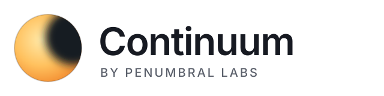
  </picture>
</p>

<p align="center">
  <b>Real-time lighting that is computed, not approximated.</b><br>
  Exact soft shadows from area lights, no noise, and nothing blended from past frames.
</p>

<p align="center">
  
  
  
  
</p>

<p align="center">
  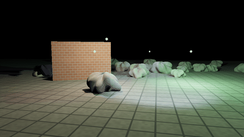
  <br>
  <sub>Real frames from the engine: a boulder moves among five lamps while the brightest one cycles through colors. Each move re-computes exactly the light it changes, in the same frame; changing a light's color re-computes nothing.</sub>
</p>

## What is Continuum?

Continuum is a real-time renderer, written in Rust on
[wgpu](https://wgpu.rs) compute shaders. It does the expensive part of
lighting (how much of each light every surface can see) exactly, and keeps
the answers until they could actually have changed. Every claim it makes is
measured against [Blender's Cycles](https://www.cycles-renderer.org/), a
reference path tracer.

It ships as a library, a [Bevy](https://bevyengine.org) plugin, and a
viewer that flies through your own glTF files. It is experimental: v0.2
works and is measured, but the API will change.

## Why it is different

### 1. One cone answers what a thousand rays would

To light a point, a renderer has to know how much of each light the point
can see. Most real-time engines estimate it, and ray tracers sample it with
random rays. Continuum sends **one cone** from the point to the whole light.
Whatever blocks the cone is recorded as bits, one per direction, and the
open share is the light that arrives.

<p align="center">
  
</p>

Because there are no random samples, there is no noise to clean up, and the
same scene gives the same image every frame.

<p align="center">
  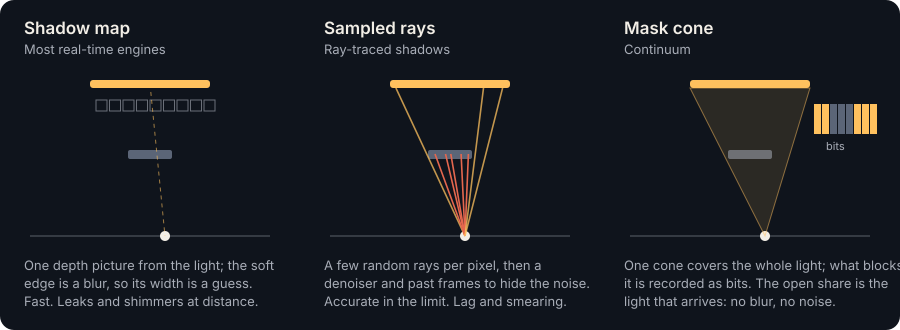
</p>

### 2. A cache that knows what can change

Computing that for every pixel, every frame, would be too slow, so
Continuum stores the light it computes on the surfaces themselves, in pages
baked for the parts of the world you look at. The trick is knowing when a
stored answer is still right:

<p align="center">
  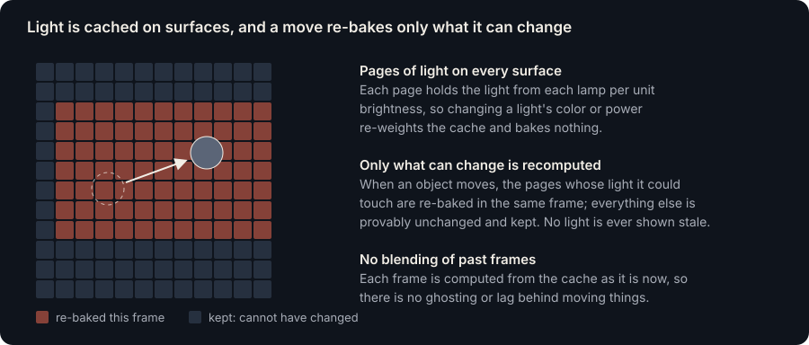
</p>

- **Changing a light's color or brightness** re-uses everything: light is
  stored per unit of brightness.
- **Moving an object** re-computes only the pages whose light it could have
  changed, within the same frame. Everything else is provably the same, so
  light is never shown stale (measured: 65 moving objects among a million
  static ones cost 1.06–1.09× a still frame).
- **Nothing is blended from previous frames.** Most real-time renderers
  smooth over noise or missing work by mixing in past frames, which leaves
  ghosts and lag behind moving things. Here each frame comes from the cache
  as it is now.

### 3. It scales to huge worlds

<p align="center">
  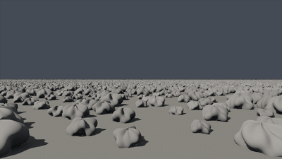
  <br>
  <sub>A million boulders, about ten billion triangles, lit by the sun and sky: real frames, flying 120 m forward and rising to 20 m. Flights over this field average 14.6–15.0 ms a frame at 1280×720 on a fanless MacBook Air (M4).</sub>
</p>

Geometry is instanced and organized in hierarchies whose coverage is
pre-filtered, so a cone crossing a distant crowd of objects reads one
summary instead of every triangle. Positions are stored in double
precision, so worlds can be kilometers across.

## How it compares

How the usual ways of lighting a scene handle soft shadows from area
lights:

| | Used in | Soft shadows | Noise and lag | Moving objects |
|---|---|---|---|---|
| Shadow maps, filtered | Most real-time engines | Approximated: the edge is blurred to an estimated width | No noise; aliasing and light leaks | Yes |
| Ray-traced shadows | Games with ray-tracing GPUs | Sampled with a few rays per pixel | Noisy; denoisers and past frames hide it, at the cost of lag and smearing | Yes |
| Real-time GI with caches and temporal accumulation (e.g. Unreal's Lumen) | Recent engines | From simplified versions of the scene | Accumulated over frames, so lighting trails behind changes | Yes, with lag |
| Baked lightmaps | Many games, architecture | Exact, computed offline | None | No: any change needs a new bake |
| Path tracing | Film, Blender's Cycles | The reference | Noisy until many samples converge; seconds or more a frame | Yes |
| **Continuum** | | **Computed per point and light by one cone: within 0.4–3% of Cycles in our tests** | **None: no random samples, no past frames** | **Yes: exact, in the same frame** |

A fair note: this compares *methods*. Continuum's numbers are measured
against Cycles; we have not benchmarked against Unreal, Unity or Godot, and
have measured speed only on an Apple M4 laptop. The table describes what
each approach approximates, not who wins a race.

## Measured, not claimed

Every feature passes a *gate*: a test whose pass criterion is written down
and committed before it runs, and whose result is recorded with exact
numbers, failures included ([docs/results/](docs/results/)). The
comparisons below are Continuum's cached lighting, settled, against Cycles
at 4,096 samples per pixel. The percentage is the relative error over the
image.

<p align="center">
  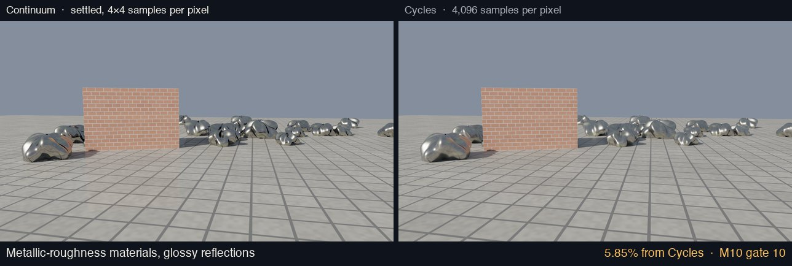
  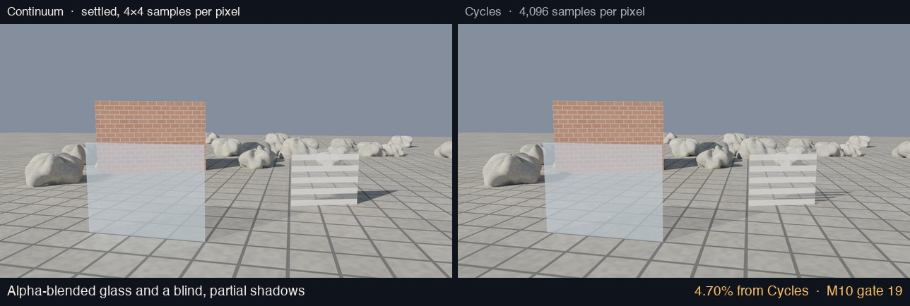
  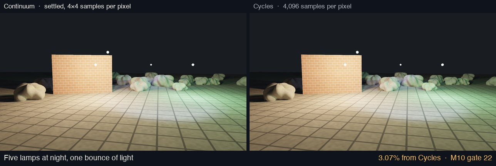
</p>

<details>
<summary>More comparisons: foliage, environment sky, normal maps</summary>

<p align="center">
  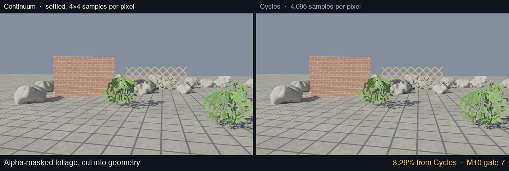
  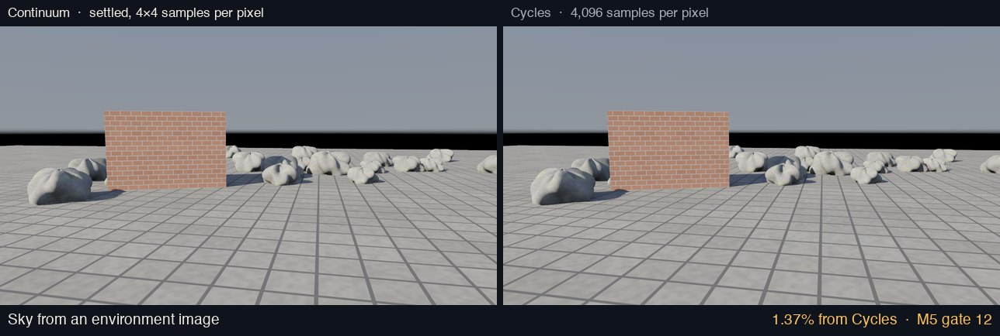
  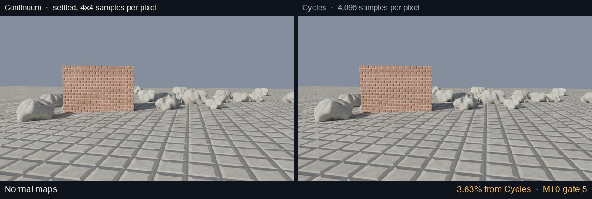
</p>

</details>

Selected numbers (1280×720, Apple M4, release builds):

| What | Result | Gate |
|---|---|---|
| A million instanced boulders (10¹⁰ triangles), flying | 14.6–15.0 ms a frame | M4 G11 |
| A textured glTF scene against Cycles | 0.43% error; 1.5 ms a warm frame | M6 G1 |
| Three colored lights over the field | 1.22% from Cycles; flights 14–15 ms | M5 G6 |
| Point and spot lights | 1.35% from Cycles | M5 G8 |
| One bounce of light | 1.79% from Cycles (7.09% without it) | M10 G1 |
| Moving objects among a million | 1.06–1.09× a still frame, never stale | M9 G1 |
| A sun moving at real speed over the million | 0.98–1.02× a still sun, every shown result within a certified bound | M9 G6 |
| A view with a sky, from an empty cache | warm in 166–400 frames (cones: 1,827–15,905) | M5 G13 |
| Light bouncing around a closed room | 6.5% from Cycles with 8 bounces (45% with one) | M10 G25 |
| Changing a light's color | free and exact: nothing is re-computed | M5 G6 |

## What it can do today

- **Lights:** rectangular area lights, suns, point and spot lights with a
  size, up to 16 of them, colored, re-colorable for free.
- **Sky:** a uniform sky, or an environment image (`.hdr`, `.png`).
- **Materials:** glTF metallic-roughness with glossy reflections, normal
  maps, emission (which lights its surroundings), emissive textures, vertex
  colors, alpha cutouts, alpha blending for glass, double-sided faces,
  texture transforms and wrap modes.
- **Indirect light**, in the cache: one bounce by default, more on request
  (`CacheOptions::bounces`; a closed room goes from 45% to 6.5% of Cycles'
  fully bounced image with eight).
- **Moving objects**, exactly, in the same frame; glTF animations play
  through them.
- **glTF 2.0** import and export, with cameras, lights and animations.
- **Bevy 0.20 plugin:** a camera's view rendered by Continuum, with
  entities moving its objects.
- **Viewer:** fly through the showcase, the boulder field, or your own file.

## Limits

Honest about where it stands:

- **Measured on Apple Silicon (Metal) only.** CI checks correctness on Linux
  (Vulkan, software adapter) and that the shaders compile for Windows
  (DX12). NVIDIA, AMD and real Windows GPUs are untested.
- **One ray per pixel,** so distant detail aliases (shimmering far away).
- **The sky warms in a few hundred frames** (hardware rays); with moving
  objects, streamed detail or glass it falls back to a slower path that
  takes thousands of frames.
- **Rigid motion only:** no skinned or morphing meshes yet.
- **Bounce light** is one bounce by default (more on request), not yet
  with moving objects; several bounces are untried with streaming.
- **Transparency** needs hardware ray queries.
- **Fanless laptops** slow down under minutes of sustained load.
- **Streaming is new:** it needs hardware ray queries; streamed lighting
  works with lights, a sky and bounce light but not yet with moving
  objects; coarser versions of objects shade slightly differently
  (about 1.2–1.5% colour difference when settled, with the finest
  version's normals); imported meshes have no coarser versions yet.

## Where it is going

The aim is to be excellent at three things: **scale, detail and
lighting**, in huge, extremely detailed worlds where detail follows the
screen (zoom in and it resolves further; what you cannot see costs
nothing). Four landmarks, in order:

1. **A unique world beyond memory** (the mechanism is there). Each
   object's finer versions load as the camera needs them, within a fixed
   budget, and detail follows the zoom: zooming in onto a rock 100 m away
   resolves it fully. What lighting sees streams too, generated as needed,
   and the lighting stays exact: every cached result shown matches one
   computed with everything loaded. 36,864 unique rocks (lighting alone
   would need 7.6 GB more GPU memory) fly at about 5 ms a frame on a
   fanless laptop, no frame over 16.7 ms, keeping about 18 KB of GPU
   memory per rock, with 900,000 cached results checked against an
   independent reference. With a sky and bounce light too, it still flies
   within 60 fps (about 10 ms a frame, direct light exact, bounce within
   3.1% of Cycles on a reference scene). Meshes that come with a single
   level, such as imported ones, can now be simplified into coarser levels
   that stream the same way and shade as close to the original as
   hand-made levels. Still to come: faster settling on new ground, and
   moving objects with it.
2. **Lighting you can trust in motion.** The cache now always converges
   with bounce light (a loop that never settled is fixed); a sun moving at
   real speed costs what a still one does, with every cached result shown
   within a certified bound of a fresh one; and a view with a sky warms in
   a few hundred frames instead of thousands (sky light through hardware
   rays, closer to Cycles than before). The error while flying is now
   measured against fully settled views (about a fifth of the image on a
   fast flight over the boulder field, mostly from the number of distinct
   objects needing lighting at once), and light can bounce more than once
   (interiors from 45% to 6.5% of Cycles' fully bounced image). The
   renderer can now report each frame an estimate of its error against
   exact lighting, with a 95% bound, from 512 probe pixels (on that
   flight the bound held in every check, for 2% of the frame).
3. **Detail smaller than a pixel, without shimmer.** Each object type
   gets a small precomputed map of how it looks from every direction, and
   pixels read those instead of tracing every tiny surface. Accuracy is
   answered (a fifth to an eighth of one-ray-per-pixel's error on the
   million-boulder field), and the coverage pass now takes about 9 ms a
   frame standing and from 150 m up (from 105–135 ms). Rays go only near large
   objects, a tile of pixels shares the top of its walk, and far groups of
   boulders hold small images of their own coverage, re-made as the
   viewpoint moves, so a pixel at the horizon reads one image instead of
   hundreds of boulders. They keep up with walking and with a 10 m/s
   flight. Colour through the same path is the open part: the structure
   works, but lighting that varies inside a pixel (bumpy rock, sharp sun
   shadows) and its speed are not there yet. It is not in the renderer
   yet.
4. **One showcase scene** with all three, at 60 fps, against Cycles.

A quality dial grows alongside: one setting for "how close to the
reference" against "how fast", instead of fixed presets.

## Try it

You need [Rust](https://rustup.rs) and a GPU wgpu supports.

```bash
cargo run --release -p viewer
```

That flies through the showcase. Other scenes:

```bash
cargo run --release -p viewer -- --scene field --scale 2
```

```bash
cargo run --release -p viewer -- --gltf your-scene.glb
```

Controls: WASD to move, Q/E down and up, Shift to move faster, drag to look,
P to pause moving objects and animations, `[` and `]` for exposure, V for
vsync, Esc to quit.

## Use it

As a library, the front door is `continuum_gpu::Renderer`: give it a scene
(geometry and placements, or a glTF file through `continuum_gltf::load`),
lights and a camera, and it renders into your texture.
[docs/GUIDE.md](docs/GUIDE.md) walks through it, and the API reference is
`cargo doc --no-deps -p continuum-gpu -p continuum-gltf --open`.

In Bevy:

```rust
use bevy::prelude::*;
use bevy_continuum::{ContinuumCamera, ContinuumPlugin, ContinuumScene};

App::new()
    .add_plugins((DefaultPlugins, ContinuumPlugin))
    .insert_resource(my_continuum_scene())
    .add_systems(Startup, |mut commands: Commands| {
        commands.spawn((Camera3d::default(), bevy::camera::Hdr, ContinuumCamera));
    })
    .run();
```

```bash
cargo run --release -p bevy_continuum --example boxes
```

## How it was built

The design and an honest status live in [docs/DESIGN.md](docs/DESIGN.md)
(§3.6 for where it stands, §3.8 for what is next). Work proceeds in
milestones of gates: M0 tested the core bets in 2D, M1 in 3D on the CPU,
and M2 onward on the GPU.

**Ideas it builds on.** Cone tracing (Amanatides 1984), coverage masks
(Carpenter's A-buffer, 1984), voxel cone tracing (Crassin et al. 2011),
prefiltered occlusion for aggregate geometry (Lacewell et al. 2008), the
render cache (Walter et al. 1999) and incremental global illumination
(Drettakis & Sillion 1997). We believe combining exact cone coverage with
caches that are recomputed only when an answer could have changed by a
bounded amount is new, but a full literature check is still to come
([DESIGN §9](docs/DESIGN.md)).

## License

Continuum is source-available under the
[PolyForm Noncommercial License 1.0.0](LICENSE.md): free for personal,
research, educational and other noncommercial use. Commercial use needs a
separate license from Penumbral Labs; open an issue to ask. Files under
`third_party/` keep their own licenses (MIT or Apache-2.0).

---

## For developers

<details>
<summary><b>The viewer in detail</b></summary>

```bash
cargo run --release -p viewer
```

Flies through the showcase: a gallery with a colonnade, an arch and a
torus-knot sculpture, lit by one skylight, with a bouncing ball and a
spinning cube. `--scene room` opens the M2 test room. C plays the camera
path.

**The million-boulder field** (`--scene field`): a 2 km plain with
1,000,000 instanced copies of a 9,800-triangle boulder, about ten billion
triangles in 152 MB of GPU memory, lit through a view-dependent lighting
cache (M4 gate 8). Pages of texels are allocated on the surfaces you look
at, coarser with distance, baked with mask cones within a frame budget, and
kept while they stay in view.

- `--boulders N` changes the count; `--scale N` renders at 1/N of the
  window; `--no-cache` lights every pixel with its own cone every frame.
- `--sky` adds a blue-white sky. Pages bake their lights first and their
  sky later, so a view comes within 5% of its warm image in 120–300 frames
  (M5 gate 9).
- `--env sky.hdr` (or a `.png`, or `gradient`) lights the scene with an
  equirectangular environment image in Blender's orientation;
  `--env-strength K` scales it (1.37% from Cycles, M5 gate 12).
- `--exposure K` sets the starting exposure.

**Your own glTF files** (`--gltf scene.glb`): lit by the file's own lights,
or else a sun (`--sky` and `--env` add a sky); seen from the file's camera
or one framed around the scene; on a grey ground (`--no-ground` leaves it
out); playing the file's first animation (not with a sky yet).
`--emitters-as-lights` makes emissive rectangles area lights
(experimental, M10 gate 23).

To render a file to an image:

```bash
cargo run --release -p continuum-gltf --example render -- scene.glb out.png
```

</details>

<details>
<summary><b>glTF support</b></summary>

`continuum_gltf::load` imports glTF 2.0 (`.gltf`, `.glb`) as instanced
scenes: meshes and node instances; base color factors and textures, sampled
at each pixel's footprint; metallic-roughness factors and textures (5.85%
from Cycles, M10 gate 10); normal maps (3.63%, M10 gate 5); emission and
emissive textures (6.35%, M10 gate 15); alpha MASK cut into geometry
(3.29%, M10 gate 7) and BLEND as blending (4.71%, M10 gate 16);
double-sided materials as exactly back-to-back faces (M10 gates 8–9);
`KHR_texture_transform`, as Blender's importer applies it; vertex colors
(1.29%, M10 gates 17–18); sampler wrap modes (2.18%, M10 gate 20);
`KHR_lights_punctual`; cameras; and node animations (translation and
rotation). `continuum_gltf::save` writes scenes back, with their materials.
A textured scene imported this way is within 0.43% of Cycles with the same
textures (M6 gate 1).

</details>

<details>
<summary><b>Comparing with other renderers</b></summary>

- `cargo run --release -p room3d --bin export_showcase` writes the showcase
  to `experiments/room3d/out/showcase/`, ready to rebuild in another
  renderer: `showcase.obj` (Z up, meters, per-vertex normals) and
  `showcase.json` (albedos, the light, the camera path and movers). Use
  non-metallic, fully rough materials with no specular and a fixed
  exposure, so differences come from lighting.
- The Cycles references are rendered by the gates themselves
  (`experiments/room3d/cycles/`); they need Blender 4.2 or later (set
  `BLENDER` if it is not in `/Applications`).
  `cargo run --release -p room3d --bin cycles_calibration` checks the
  pipeline on a scene with a known answer.
- `cargo run --release -p room3d --bin bench` repeats the gates' timings in
  one headless run, to compare GPUs (`docs/BENCHMARK.md`;
  `docs/results/bench-m4.md` holds the M4 baseline).

</details>

<details>
<summary><b>Repository layout</b></summary>

- `crates/continuum`: the core: direction masks (binary and continuous),
  the error ledger, 3D cones, a BVH, meshes with charts.
- `crates/continuum-gpu`: the wgpu compute backend: `Renderer` (the
  library's front door), mask cones in WGSL, the lighting caches.
- `crates/continuum-gltf`: glTF 2.0 import and export, and the `render`
  example.
- `crates/bevy_continuum`: the Bevy 0.20 plugin and the `boxes` example.
- `apps/viewer`: the real-time viewer.
- `experiments/flatland`: the 2D experiments that tested the core bets
  (M0).
- `experiments/room3d`: the 3D experiments and gates
  (`src/bin/m<milestone>_gate<n>.rs`), test scenes, and the Cycles
  pipeline.
- `docs/`: the design document, the guide, and every result.
- `scripts/`: the README's diagrams (`readme_diagrams.py`) and GIFs
  (`make_gif.py`, from frames written by the `readme_media` binary).
- `third_party/`: a small patch to wgpu-core (see its README).

</details>

<details>
<summary><b>Running the tests and gates</b></summary>

```bash
cargo test --release
```

Each gate is a binary that prints its verdict and writes its images to
`experiments/<crate>/out/`:

```bash
cargo run --release -p flatland --bin gate1
cargo run --release -p room3d --bin m3_gate3        # needs Blender
cargo run --release -p room3d --bin m10_gate20      # needs Blender
```

The pattern is `cargo run --release -p room3d --bin m<milestone>_gate<n>`;
results are in `docs/results/`, one file per gate. Early milestones (M0–M4)
are described in `docs/DESIGN.md` §3.5 and §6, with images in
`docs/images/`.

</details>

<p align="center"><sub>Continuum is made by Penumbral Labs.</sub></p>
