<p align="center">
  <picture>
    <source media="(prefers-color-scheme: dark)" srcset="docs/images/brand/logo-dark.svg">
    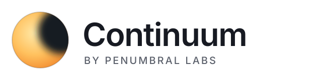
  </picture>
</p>

<p align="center">
  <b>Real-time lighting that is computed, not approximated.</b><br>
  Exact soft shadows from area lights, no noise, and nothing blended from past frames.
</p>

<p align="center">
  
  
  
  
</p>

<p align="center">
  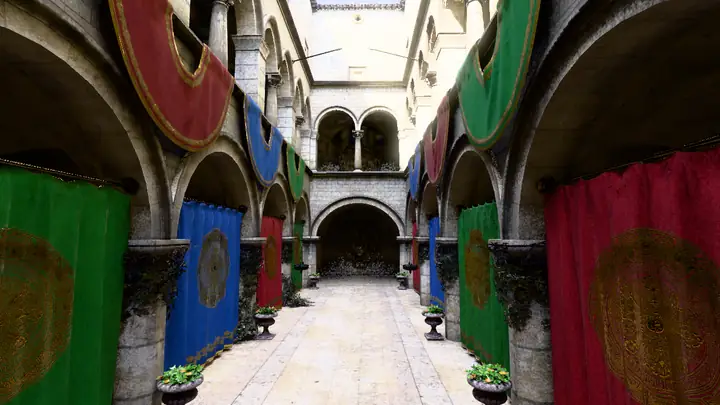
  <br>
  <sub>Real frames: Sponza (3 million triangles) under an outdoor HDRI, its sun and three more lights taken from the image, with bounce light, anti-aliasing, tone mapping and bloom, as the viewer shows it. Nothing in any frame comes from an earlier one.</sub>
</p>

<p align="center">
  <a href="#at-a-glance">At a glance</a> ·
  <a href="#gallery">Gallery</a> ·
  <a href="#how-it-works">How it works</a> ·
  <a href="#measured-not-claimed">Measured</a> ·
  <a href="#try-it">Try it</a> ·
  <a href="#use-it">Use it</a> ·
  <a href="#where-it-stands">Where it stands</a> ·
  <a href="#where-it-is-going">Where it is going</a>
</p>

## At a glance

Continuum is a real-time renderer, written in Rust on
[wgpu](https://wgpu.rs) compute shaders. It does the expensive part of
lighting (how much of each light every surface can see) exactly, and keeps
the answers until they could actually have changed. Every claim it makes is
measured against [Blender's Cycles](https://www.cycles-renderer.org/), a
reference path tracer.

| **Exact** | **Instant** | **Huge** |
|---|---|---|
| One cone from a point to a whole light answers what it can see: soft shadows from area lights, with no random samples and no noise, within 0.4–3% of Cycles in our tests. | Light is cached on surfaces and recomputed only where it could have changed, in the same frame. Re-coloring a light costs nothing; nothing is blended from past frames. | Instanced and streamed worlds: a million boulders (ten billion triangles) or 36,864 unique streamed rocks, flown at 60 fps on a fanless laptop. |

It ships as a library, a [Bevy](https://bevyengine.org) plugin, and a
viewer that flies through your own glTF files. It is experimental: v0.3
works and is measured, but the API will change.

| | |
|---|---|
| **Try it in a minute** | On a Mac with Apple silicon, one Terminal command installs the viewer ([Try it](#try-it)); drop a `.glb` file on it and fly around. |
| **Good at** | Soft shadows from area lights that are exact and free of noise in every frame; very large instanced or streamed worlds; lights that change color at no cost. |
| **Runs on** | Apple silicon Macs (Metal): tested and measured. Linux (Vulkan): the tests pass on a software GPU. Windows, NVIDIA and AMD: untested, and may not run yet. Needs a GPU with compute shaders; glass and streaming need hardware ray tracing. |
| **Not yet** | Bounce light from moving lights, phones and the web, a stable API. See [Where it stands](#where-it-stands). |
| **License** | Free for noncommercial use ([PolyForm Noncommercial 1.0.0](LICENSE.md)). Commercial use needs a license from Penumbral Labs: [open an issue](https://github.com/bupfff/continuum/issues). |

## Gallery

Real assets opened as they are, with the viewer's defaults (an object in the
studio HDRI, its softboxes made lights with exact soft shadows; a larger
scene outdoors), on an M4 MacBook Air.

<p align="center">
  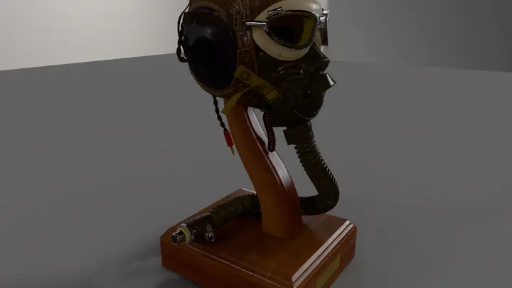
  <br>
  <sub>FlightHelmet (CC0) in the studio HDRI: its softboxes are lights with exact soft shadows; the camera orbits, the lighting stays still and exact.</sub>
</p>

| | | |
|---|---|---|
| 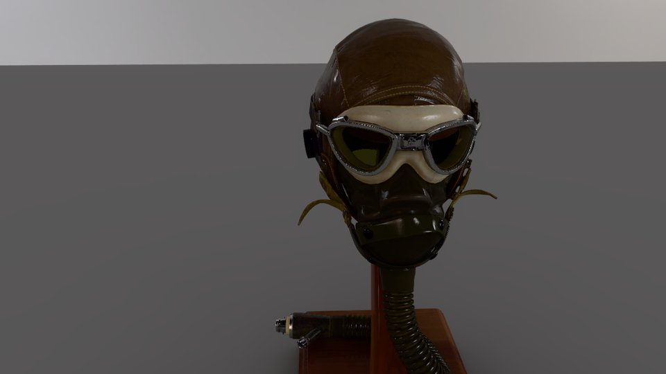 | 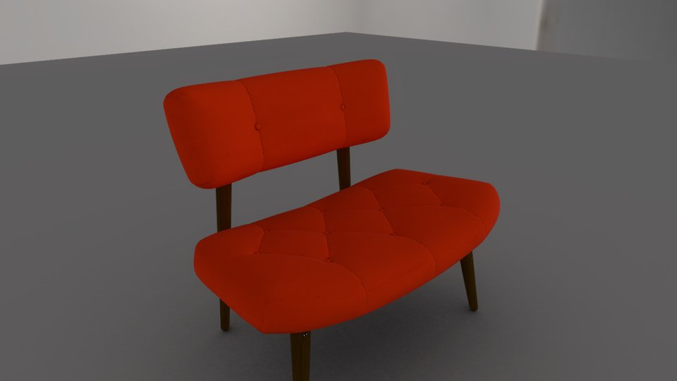 | 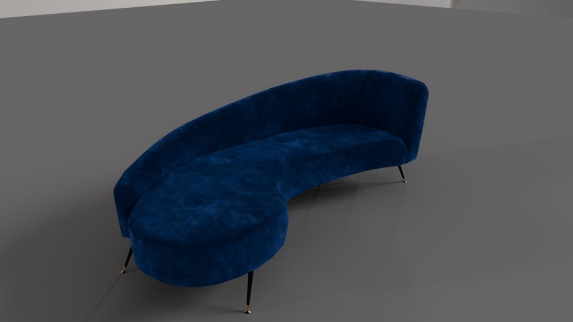 |
| FlightHelmet (CC0) | SheenChair: sheen fabric (Wayfair, CC0) | GlamVelvetSofa: velvet (Wayfair, CC BY 4.0) |
| 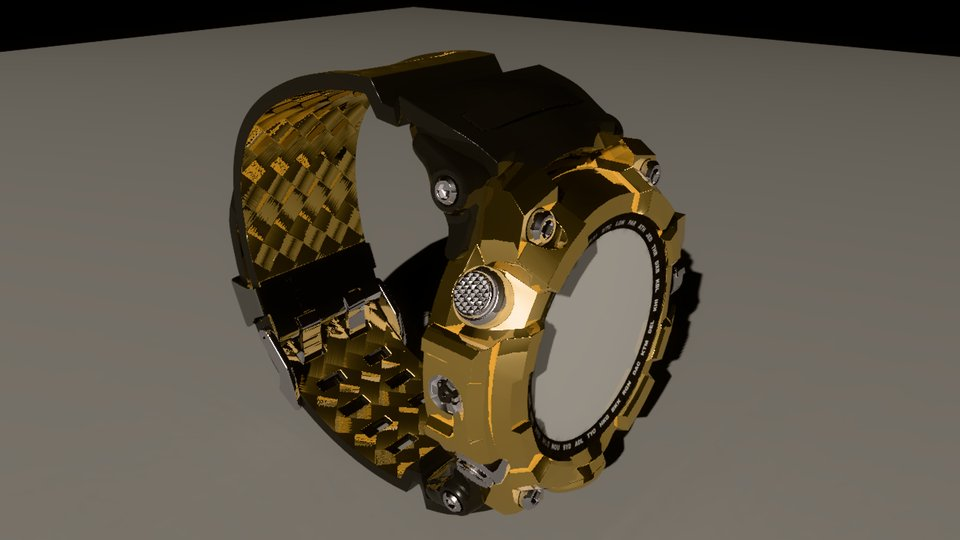 | 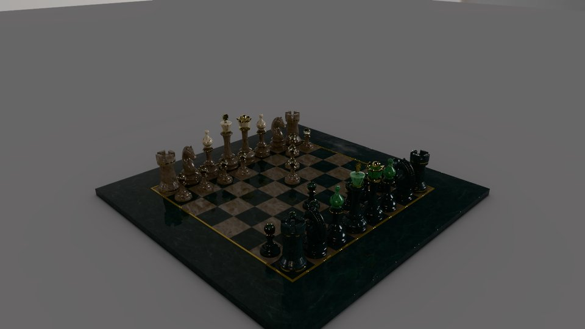 | 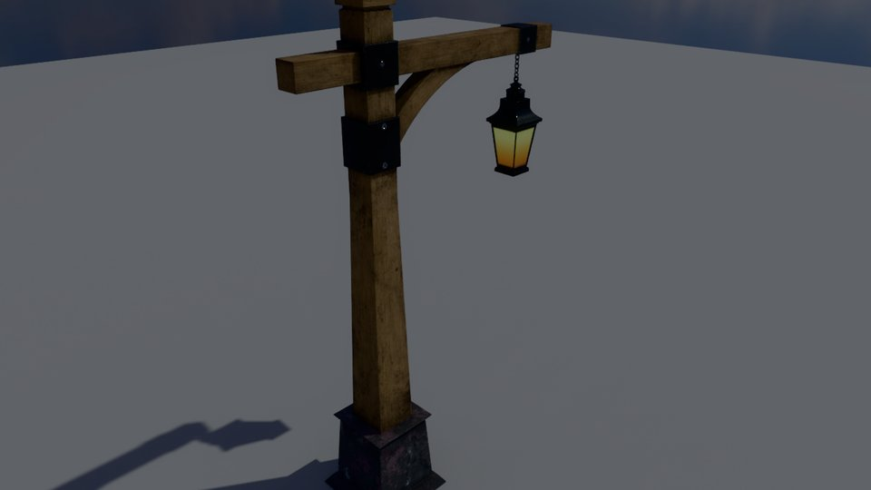 |
| ChronographWatch (graphiccompressor and Darmstadt Graphics Group, CC BY 4.0) | A Beautiful Game: 1.5 million triangles (ASWF and Ed Mackey, CC BY 4.0) | Lantern (Microsoft, CC0) |

<p align="center">
  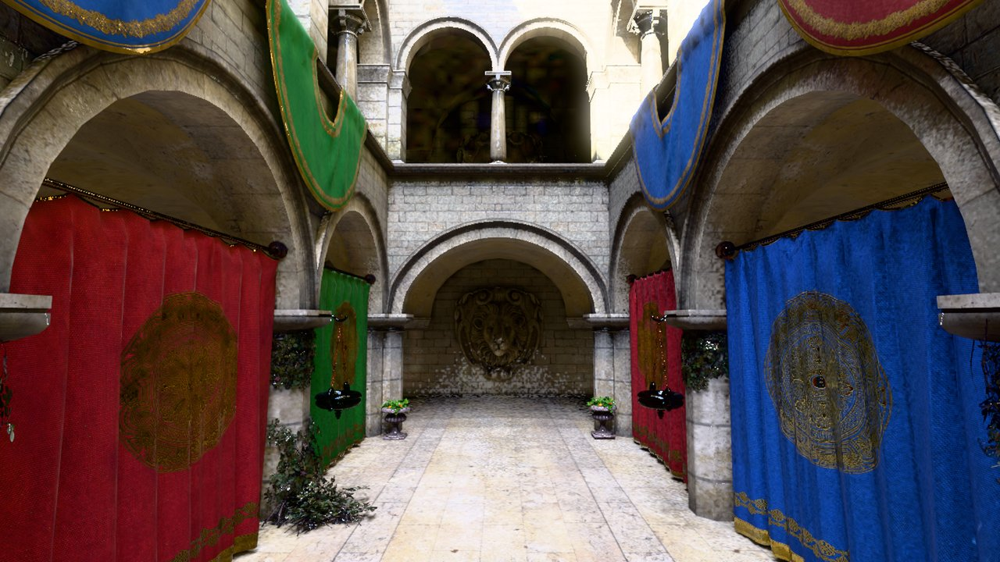
  <br>
  <sub>Sponza (Crytek, CRYENGINE Limited License Agreement): 3 million triangles once its ivy and flowers are cut out, under the outdoor HDRI, 25.6 ms a frame at 2560×1440 (rendered at half).</sub>
</p>

Models from the [Khronos glTF Sample Assets](https://github.com/KhronosGroup/glTF-Sample-Assets);
HDRIs Studio Small 09 and Kloofendal 48d Partly Cloudy (Pure Sky) from [Poly Haven](https://polyhaven.com) (CC0). Each
is compared with Cycles in [`docs/results/assets-vs-cycles.md`](docs/results/assets-vs-cycles.md).

## How it works

### One cone answers what a thousand rays would

To light a point, a renderer has to know how much of each light the point
can see. Most real-time engines estimate it, and ray tracers sample it with
random rays. Continuum sends **one cone** from the point to the whole light.
Whatever blocks the cone is recorded as bits, one per direction, and the
open share is the light that arrives.

<p align="center">
  
</p>

Because there are no random samples, there is no noise to clean up, and the
same scene gives the same image every frame.

<p align="center">
  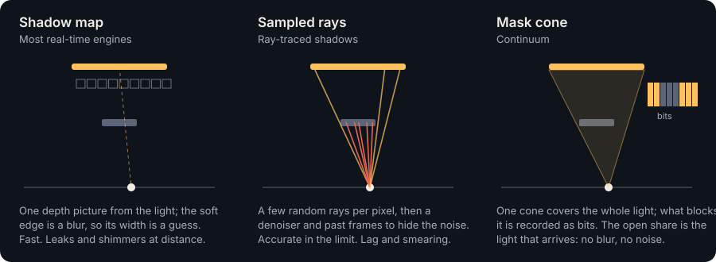
</p>

### A cache that knows what can change

Computing that for every pixel, every frame, would be too slow, so
Continuum stores the light it computes on the surfaces themselves, in pages
baked for the parts of the world you look at. The trick is knowing when a
stored answer is still right.

<p align="center">
  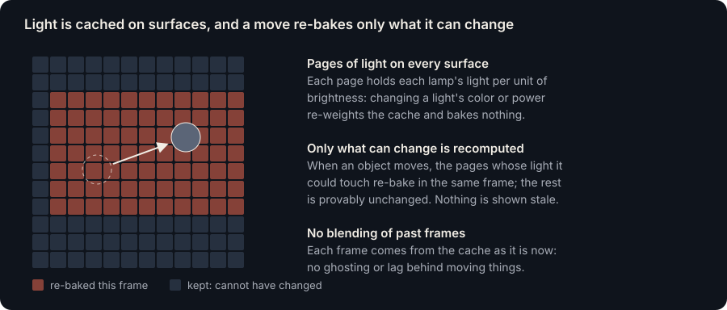
</p>

<p align="center">
  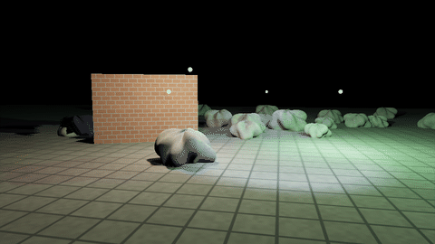
  <br>
  <sub>A boulder moves among five lamps while the brightest one cycles through colors: each move re-computes exactly the light it changes, in the same frame (65 moving objects among a million static ones cost 1.06–1.09× a still frame); re-coloring re-computes nothing.</sub>
</p>

### What one frame does

<p align="center">
  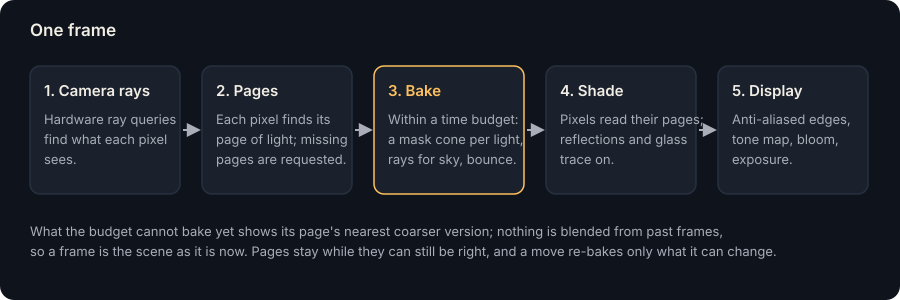
</p>

A texel's light is computed at its centre. Far away, one texel can cover a
whole curved object, and its centre can stand for it badly, so texels that
cover a curve take their light from points spread over their area:

<p align="center">
  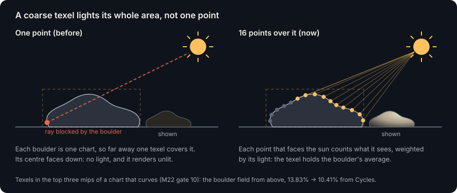
</p>

### It scales to huge worlds

<p align="center">
  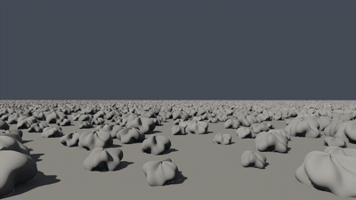
  <br>
  <sub>A million boulders, about ten billion triangles, lit by the sun and sky: real frames, flying 120 m forward and rising to 20 m. Flights over this field average 14.6–15.0 ms a frame at 1280×720 on a fanless MacBook Air (M4).</sub>
</p>

Geometry is instanced and organized in hierarchies whose coverage is
pre-filtered, so a cone crossing a distant crowd of objects reads one
summary instead of every triangle. Positions are stored in double
precision, so worlds can be kilometers across, and unique geometry can
stream in as the camera needs it, within a fixed memory budget.

## Measured, not claimed

Every feature passes a *gate*: a test whose pass criterion is written down
and committed before it runs, and whose result is recorded with exact
numbers, failures included ([docs/results/](docs/results/)). Gates that
fail stay failed; fixes go into new gates.

The **basics scorecard** checks seven fixed scenes, from a closed room to
skinned characters, a million boulders and Sponza, for speed and against
Cycles, after every change that may move them
([`docs/results/basics-scorecard.md`](docs/results/basics-scorecard.md)):

<p align="center">
  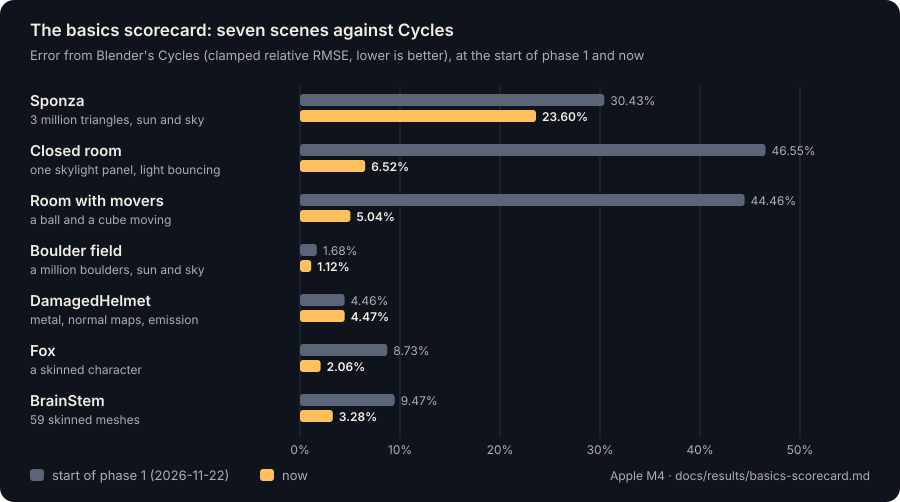
</p>

The comparisons below are Continuum's cached lighting, settled, against
Cycles at 4,096 samples per pixel. The percentage is the relative error over
the image.

<p align="center">
  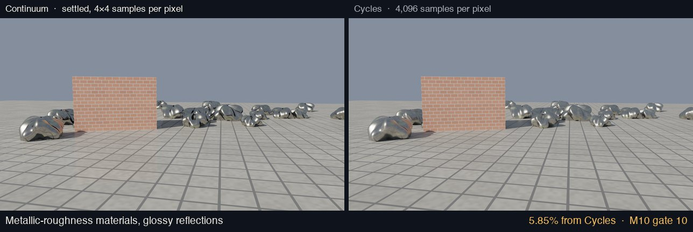
  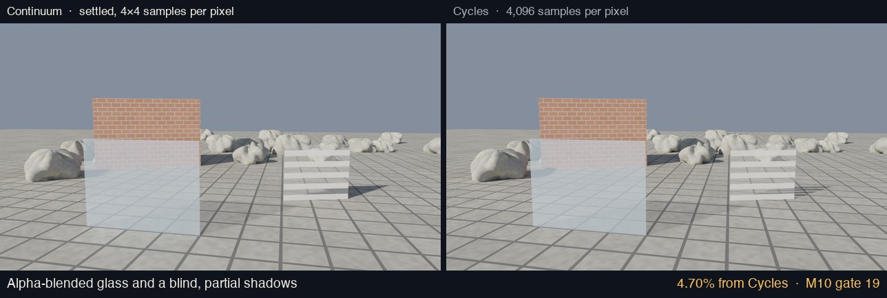
  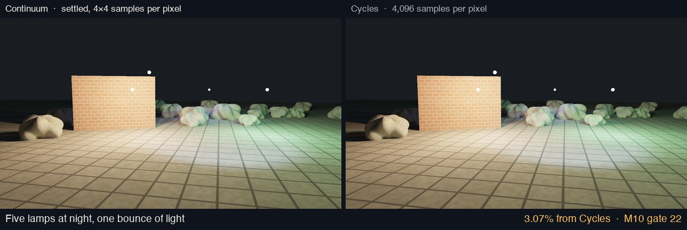
</p>

<details>
<summary>More comparisons: foliage, environment sky, normal maps</summary>

<p align="center">
  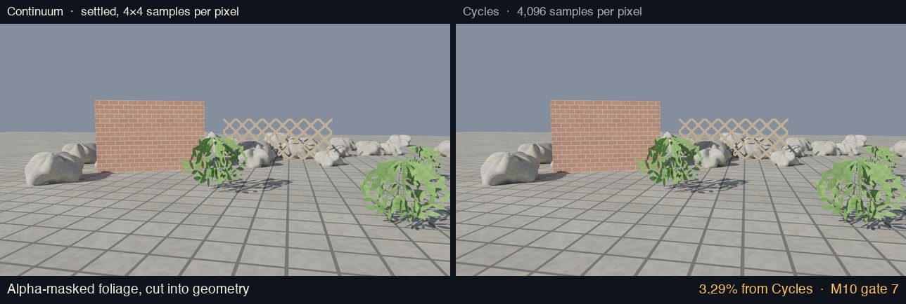
  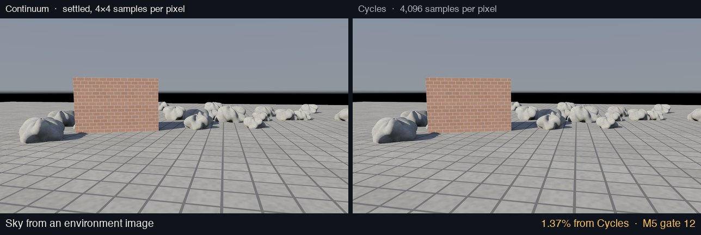
  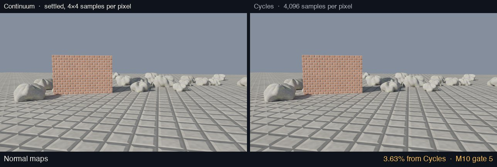
</p>

</details>

Selected numbers (1280×720, Apple M4, release builds):

| What | Result | Gate |
|---|---|---|
| A million instanced boulders (10¹⁰ triangles), flying | 14.6–15.0 ms a frame | M4 G11 |
| 36,864 unique streamed rocks with a sky and bounce light, flying | 9.2–10.2 ms a frame, 99th percentile under 16.7 ms | M14 G10 |
| A textured glTF scene against Cycles | 0.43% error; 1.5 ms a warm frame | M6 G1 |
| Three colored lights over the field | 1.22% from Cycles; flights 14–15 ms | M5 G6 |
| Point and spot lights | 1.35% from Cycles | M5 G8 |
| A closed room's bounce light, by default | 5.84% from Cycles' fully bounced image (46.55% with one bounce) | M22 G8, M25 G1 |
| The million-boulder field with bounce light settling | 10 s (never within a minute before), 1.24% from Cycles | M23 G3 |
| Moving objects among a million | 1.06–1.09× a still frame, never stale | M9 G1 |
| A sun moving at real speed over the million | 0.98–1.02× a still sun, every shown result within a certified bound | M9 G6 |
| The boulder field from 40 m up | 11.67% from Cycles with bounce light; 10.41% without (13.83% before coarse texels averaged their area) | M22 G10, M25 G1 |
| Changing a light's color | free and exact: nothing is re-computed | M5 G6 |
| Anti-aliasing at edges, in a slow turn | 0.31–0.38× one ray's error; frame-to-frame 0.30–0.42× | M15 G1 |
| Thin glass against Cycles | 5.08% (drawn opaque 85%, as alpha blending 14%); 1.22× the frame | M16 G2 |

### How it compares

How the usual ways of lighting a scene handle soft shadows from area
lights:

| | Used in | Soft shadows | Noise and lag | Moving objects |
|---|---|---|---|---|
| Shadow maps, filtered | Most real-time engines | Approximated: the edge is blurred to an estimated width | No noise; aliasing and light leaks | Yes |
| Ray-traced shadows | Games with ray-tracing GPUs | Sampled with a few rays per pixel | Noisy; denoisers and past frames hide it, at the cost of lag and smearing | Yes |
| Real-time GI with caches and temporal accumulation (e.g. Unreal's Lumen) | Recent engines | From simplified versions of the scene | Accumulated over frames, so lighting trails behind changes | Yes, with lag |
| Baked lightmaps | Many games, architecture | Exact, computed offline | None | No: any change needs a new bake |
| Path tracing | Film, Blender's Cycles | The reference | Noisy until many samples converge; seconds or more a frame | Yes |
| **Continuum** | | **Computed per point and light by one cone: direct soft shadows within 0.4–3% of Cycles in our tests** | **None: no random samples, no past frames** | **Yes: exact, in the same frame** |

A fair note: this compares *methods*. Continuum's numbers are measured
against Cycles; we have not benchmarked against Unreal, Unity or Godot, and
have measured speed only on an Apple M4 laptop. Whole scenes with bounce
light come further from Cycles than direct light alone (the scorecard
above: 1.3% to 25%).

## Try it

**On a Mac with Apple silicon,** paste this into Terminal:

```bash
curl -fsSL https://raw.githubusercontent.com/bupfff/continuum/main/scripts/install_macos.sh | sh
```

It downloads the [latest release](https://github.com/bupfff/continuum/releases/latest)'s
app, checks it against the checksum GitHub publishes, puts **Continuum
Viewer** in `~/Applications` and opens it ([the script](scripts/install_macos.sh)).
Or download `continuum-viewer-…-macos-arm64.zip` from the release in a
browser, unzip it and open the app: it is not notarized by Apple, so macOS
refuses a browser download the first time. Open **System Settings →
Privacy & Security**, scroll down and click **Open Anyway**.

The panel at the top left picks a scene (a gallery, a field of up to a
million boulders, or your own glTF file: **Open a glTF file…**, or drop a
`.glb` or `.gltf` on the window), how it is lit (**Lighting**: the sun, the
sun and sky, a studio or outdoor HDRI that come with the viewer, or **Open
HDR…** for your own) and how it renders. Objects open in the studio and
larger scenes outdoors, from inside at eye height. W A S D move, drag to
look, Shift to go faster, H hides the panel.

**From source, on any platform** (you need [Rust](https://rustup.rs); the
first build takes a few minutes):

```bash
git clone https://github.com/bupfff/continuum
cd continuum
cargo run --release -p viewer
```

Add a file to open it straight away
(`cargo run --release -p viewer -- your-scene.glb`); the
[viewer's documentation](apps/viewer/src/main.rs) lists its options.

## Use it

Continuum is not on crates.io yet; add it from GitHub:

```toml
[dependencies]
continuum = { git = "https://github.com/bupfff/continuum", tag = "v0.3.2" }
continuum-gpu = { git = "https://github.com/bupfff/continuum", tag = "v0.3.2" }
continuum-gltf = { git = "https://github.com/bupfff/continuum", tag = "v0.3.2" }

# Recommended: wgpu with two fixes for scenes with very many instances
# (third_party/README.md). Everything works without them, more slowly.
[patch.crates-io]
wgpu-core = { git = "https://github.com/bupfff/continuum", tag = "v0.3.2" }
wgpu-hal = { git = "https://github.com/bupfff/continuum", tag = "v0.3.2" }
```

The front door is `continuum_gpu::Renderer`: give it a scene, lights and a
camera, and it renders into your wgpu texture. In outline:

```rust
let imported = continuum_gltf::load("scene.glb".as_ref())?;
let mut renderer = Renderer::new(
    MaskConeKernel::new().ok_or("no GPU")?, // or with_device(device, queue, name)
    wgpu::TextureFormat::Rgba8UnormSrgb,
    (1280, 720),
    &imported.scene,
    origin, // a point near the camera; lights and cameras are relative to it
    &lights,
    RendererOptions::default(),
);
// Each frame:
renderer.render(camera, &view);
```

The whole program, with the file's own lights and camera, is
[`examples/render.rs`](crates/continuum-gltf/examples/render.rs) (a glTF
file to a PNG):

```bash
cargo run --release -p continuum-gltf --example render -- scene.glb out.png
```

[docs/GUIDE.md](docs/GUIDE.md) walks through the rest, and
`cargo doc --no-deps -p continuum-gpu -p continuum-gltf --open` is the API
reference.

**In Bevy,** `bevy_continuum` renders a camera's view with Continuum. Its
[example](crates/bevy_continuum/examples/boxes.rs) builds a scene in code:

```bash
cargo run --release -p bevy_continuum --example boxes
```

and sets the plugin up like this (`scene()` is the example's, returning a
`ContinuumScene`: geometry, lights and renderer options):

```rust
App::new()
    .add_plugins((DefaultPlugins, ContinuumPlugin))
    .insert_resource(scene())
    .add_systems(Startup, |mut commands: Commands| {
        commands.spawn((Camera3d::default(), bevy::camera::Hdr, ContinuumCamera));
    })
    .run();
```

## Where it stands

<details open>
<summary><b>What it can do today</b></summary>

- **Lights:** rectangular area lights, suns, point and spot lights with a
  size, up to 16 of them, colored, re-colorable for free.
- **Sky:** a uniform sky, or an environment image (`.hdr`, `.png`).
- **Materials:** glTF metallic-roughness with glossy reflections, normal
  maps, emission (which lights its surroundings), emissive textures, vertex
  colors, alpha cutouts, alpha blending, transmissive glass, thin
  (`KHR_materials_transmission`: full reflections, tinted light through,
  5.08% from Cycles) or solid (`KHR_materials_volume`: refraction in and
  out, absorption, total internal reflection; 8.3% from Cycles), clear
  coats and a surface's index of refraction and tinted reflectance
  (`KHR_materials_clearcoat`, `_ior`, `_specular`), sheen for fabrics
  (`KHR_materials_sheen`), double-sided faces, texture transforms and wrap
  modes.
- **Indirect light**, in the cache: by default two bounces with the rest
  estimated where only local lights light the scene (a closed room 5.8%
  from Cycles' fully bounced image, 46.6% with one), one bounce outdoors
  (a sky, an environment or a sun); more on request
  (`CacheOptions::bounces`). Bounce rays' hits are lit by rays, so a view
  settles without waiting on the pages of everything its bounce rays
  reach.
- **Moving objects**, exactly, in the same frame; glTF animations play
  through them.
- **Animated characters:** glTF skins and morph targets, posed as Blender
  poses them (within a micrometre); any mesh the application deforms each
  frame. Lighting near a deforming object catches up within a budget.
- **Anti-aliasing,** on by default, with nothing taken from past frames:
  edge pixels trace up to eight more rays, shaded where they meet another
  surface.
- **Fog with light shafts:** a layer of fog, even or thinning with height,
  lit by the sun through its shadows and by the sky; within 6–10% of
  Cycles' volumes, 0.8 ms at 720p.
- **Display:** Khronos PBR Neutral tone mapping (within half a level in 255
  of Blender's view of it) or an AgX approximation; auto-exposure that
  adapts like a camera, metering surfaces so an empty or dim sky does not
  flood the view; bloom that keeps the image's light; rendering below the
  display's size drawn up by a clamped bicubic.
- **Depth of field** and **motion blur,** each from the frame alone (a thin
  lens: 0.03–0.13× a pinhole's error from the lens sampled outright; a
  shutter: 0.07–0.34× a still image's error), 0.6–2.5 ms at 720p.
- **glTF 2.0** import and export, with cameras, lights and animations.
- **Bevy 0.20 plugin:** a camera's view rendered by Continuum, with
  entities moving its objects.
- **Viewer:** fly through the showcase, the boulder field, or your own
  file, with a panel for its settings; a download for Apple silicon Macs.

</details>

<details open>
<summary><b>Limits</b></summary>

- **Measured on Apple silicon (Metal) only.** CI checks correctness on Linux
  (Vulkan, software adapter) and that the shaders compile for Windows
  (DX12). NVIDIA, AMD and real Windows GPUs are untested.
- **Bounce light costs time to settle at scale.** On by default
  (1.06–1.12× the frame and about 190 MB of GPU memory): the
  million-boulder field under its sun and sky settles in about 10 s, Sponza
  in about 30 s. Under a sun alone (two bounces) the field still takes
  minutes. Not yet with moving lights.
- **Real assets still come further from Cycles than test scenes:** Sponza
  is 24% from Cycles (bounce light's sampling of small bright patches, and
  materials), against 1.1–7% for the scorecard's other scenes.
- **Detail smaller than a pixel** still shimmers far away: anti-aliasing
  smooths edges, but a field of tiny distant objects needs the
  experimental sub-pixel path (static scenes), where anti-aliasing costs
  about 2× the frame.
- **The sky warms in a few hundred frames** (hardware rays); with streamed
  detail or glass it falls back to a slower path that takes thousands of
  frames. Around moving objects the sky catches up within a few frames
  (`CacheOptions::sky_lag`, on by default).
- **Deforming meshes are costly:** a character large on screen costs about
  1.6× the frame, and the lighting near it lags its motion (up to about a
  second) until it stops.
- **Moving objects near a large light can be slow:** shadows of moving
  objects stay exact by re-baking every texel they touch in the same frame;
  in a closed room with a large light that is tens of thousands of texels a
  frame.
- **Transparency** needs hardware ray queries. Glass is sharp even when
  rough, its shadows are grey rather than tinted and carry no caustics.
- **Fanless laptops** slow down under minutes of sustained load.
- **Streaming is new:** it needs hardware ray queries, and does not yet work
  with moving objects; imported meshes stream once simplified into coarser
  levels.

</details>

## Where it is going

The aim is to be excellent at three things: **scale, detail and
lighting**, in huge, extremely detailed worlds where detail follows the
screen (zoom in and it resolves further; what you cannot see costs
nothing). The work runs in three phases:

1. **Strengthen the basics** (now): every scene on the
   [scorecard](docs/results/basics-scorecard.md) settling, no visible gaps
   in motion, and real scenes within a stated bar of Cycles. Done so far:
   bounce light by default (a closed room 46.6% → 6.9% from Cycles),
   characters in motion (pixels without lighting 38% → 2.2%), a fix that
   brought Sponza from 30.4% to 23.6%, coarse texels that average their
   area, and bounce light that settles everywhere on the scorecard (the
   boulder field in 9 s, Sponza in 31 s). Next: the field under a sun
   alone, and the rest of Sponza's gap.
2. **Compatibility:** the glTF features and effects still missing (a second
   texture coordinate set, the remaining material extensions, particles,
   decals, animated emission), checked by a compatibility scorecard.
3. **Make it look good:** scenes that look their best with this engine, not
   only correct.

Along the way, four landmarks, each with its mechanism in place:

- **A unique world beyond memory:** 36,864 unique rocks stream geometry and
  lighting within a fixed budget, flown within 60 fps, every cached result
  shown matching one computed with everything loaded.
- **Lighting you can trust in motion:** a moving sun costs what a still one
  does, every shown result within a certified bound; the renderer can
  report each frame an estimate of its error with a 95% bound.
- **Detail smaller than a pixel, without shimmer:** objects carry small
  precomputed maps of their coverage from every direction, so a pixel at
  the horizon reads one image instead of hundreds of boulders
  (`RendererOptions::sub_pixel`, experimental).
- **One showcase scene** with all three, at 60 fps, against Cycles.

The design and an honest status live in [docs/DESIGN.md](docs/DESIGN.md)
(§3.6 for where it stands, §3.8 for what is next).

## How it was built

Work proceeds in milestones of gates: M0 tested the core bets in 2D, M1 in
3D on the CPU, and M2 onward on the GPU.

**Ideas it builds on.** Cone tracing (Amanatides 1984), coverage masks
(Carpenter's A-buffer, 1984), voxel cone tracing (Crassin et al. 2011),
prefiltered occlusion for aggregate geometry (Lacewell et al. 2008), the
render cache (Walter et al. 1999) and incremental global illumination
(Drettakis & Sillion 1997). We believe combining exact cone coverage with
caches that are recomputed only when an answer could have changed by a
bounded amount is new, but a full literature check is still to come
([DESIGN §9](docs/DESIGN.md)).

## License

Continuum is source-available under the
[PolyForm Noncommercial License 1.0.0](LICENSE.md): free for personal,
research, educational and other noncommercial use. Commercial use needs a
separate license from Penumbral Labs; open an issue to ask. Files under
`third_party/` keep their own licenses (MIT or Apache-2.0).

---

## For developers

<details>
<summary><b>The viewer in detail</b></summary>

```bash
cargo run --release -p viewer
```

Flies through the showcase: a gallery with a colonnade, an arch and a
torus-knot sculpture, lit by one skylight, with a bouncing ball and a
spinning cube. `--scene room` opens the M2 test room. C plays the camera
path.

**The million-boulder field** (`--scene field`): a 2 km plain with
1,000,000 instanced copies of a 9,800-triangle boulder, about ten billion
triangles in 152 MB of GPU memory, lit through a view-dependent lighting
cache (M4 gate 8). Pages of texels are allocated on the surfaces you look
at, coarser with distance, baked with mask cones within a frame budget, and
kept while they stay in view.

- `--boulders N` changes the count; `--scale N` renders at 1/N of the
  window; `--no-cache` lights every pixel with its own cone every frame.
- `--sky` adds a blue-white sky. Pages bake their lights first and their
  sky later, so a view comes within 5% of its warm image in 120–300 frames
  (M5 gate 9).
- `--env sky.hdr` (or a `.png`, or `gradient`) lights the scene with an
  equirectangular environment image in Blender's orientation;
  `--env-strength K` scales it (1.37% from Cycles, M5 gate 12).
- `--exposure K` sets the starting exposure; `--no-vsync` turns vsync off.

**Your own glTF files** (`--gltf scene.glb`): lit by the file's own lights
and the sky, or else a studio HDRI (objects under 10 m across) or an
outdoor one (larger scenes, whose sun becomes a light with exact soft
shadows); `--sky`, `--no-sky` and `--env` choose instead. Seen from the
file's camera, or framed around an object, or from inside a large scene at
eye height; on a grey ground (`--no-ground` leaves it out); playing the
file's first animation (under a sky or HDRI the sky around moving things
catches up within a few frames).
`--emitters-as-lights` makes emissive rectangles area lights
(experimental, M10 gate 23).

To render a file to an image:

```bash
cargo run --release -p continuum-gltf --example render -- scene.glb out.png
```

</details>

<details>
<summary><b>glTF support</b></summary>

`continuum_gltf::load` imports glTF 2.0 (`.gltf`, `.glb`) as instanced
scenes: meshes and node instances; base color factors and textures, sampled
at each pixel's footprint; metallic-roughness factors and textures (5.85%
from Cycles, M10 gate 10); normal maps (3.63%, M10 gate 5); emission and
emissive textures (6.35%, M10 gate 15); alpha MASK cut into geometry
(3.29%, M10 gate 7) and BLEND as blending (4.71%, M10 gate 16);
double-sided materials as exactly back-to-back faces (M10 gates 8–9);
`KHR_texture_transform`, as Blender's importer applies it; vertex colors
(1.29%, M10 gates 17–18); sampler wrap modes (2.18%, M10 gate 20);
`KHR_lights_punctual`; cameras; and node animations (translation and
rotation). `continuum_gltf::save` writes scenes back, with their materials.
A textured scene imported this way is within 0.43% of Cycles with the same
textures (M6 gate 1).

</details>

<details>
<summary><b>Comparing with other renderers</b></summary>

- `cargo run --release -p room3d --bin export_showcase` writes the showcase
  to `experiments/room3d/out/showcase/`, ready to rebuild in another
  renderer: `showcase.obj` (Z up, meters, per-vertex normals) and
  `showcase.json` (albedos, the light, the camera path and movers). Use
  non-metallic, fully rough materials with no specular and a fixed
  exposure, so differences come from lighting.
- The Cycles references are rendered by the gates themselves
  (`experiments/room3d/cycles/`); they need Blender 4.2 or later (set
  `BLENDER` if it is not in `/Applications`).
  `cargo run --release -p room3d --bin cycles_calibration` checks the
  pipeline on a scene with a known answer.
- `cargo run --release -p room3d --bin scorecard` runs the basics scorecard
  (seven scenes, speed then error against Cycles; about 5 minutes once the
  references are cached).
- `cargo run --release -p room3d --bin bench` repeats the gates' timings in
  one headless run, to compare GPUs (`docs/BENCHMARK.md`;
  `docs/results/bench-m4.md` holds the M4 baseline).

</details>

<details>
<summary><b>Repository layout</b></summary>

- `crates/continuum`: the core: direction masks (binary and continuous),
  the error ledger, 3D cones, a BVH, meshes with charts.
- `crates/continuum-gpu`: the wgpu compute backend: `Renderer` (the
  library's front door), mask cones in WGSL, the lighting caches.
- `crates/continuum-gltf`: glTF 2.0 import and export, and the `render`
  example.
- `crates/bevy_continuum`: the Bevy 0.20 plugin and the `boxes` example.
- `apps/viewer`: the real-time viewer.
- `experiments/flatland`: the 2D experiments that tested the core bets
  (M0).
- `experiments/room3d`: the 3D experiments and gates
  (`src/bin/m<milestone>_gate<n>.rs`), test scenes, the basics scorecard,
  and the Cycles pipeline.
- `docs/`: the design document, the guide, and every result.
- `scripts/`: the README's diagrams (`readme_diagrams.py`) and animations
  (`make_gif.py`, GIF or WebP, from frames written by the `readme_media`
  and `readme_clips` binaries).
- `third_party/`: a small patch to wgpu-core (see its README).

</details>

<details>
<summary><b>Running the tests and gates</b></summary>

```bash
cargo test --release
```

Each gate is a binary that prints its verdict and writes its images to
`experiments/<crate>/out/`:

```bash
cargo run --release -p flatland --bin gate1
cargo run --release -p room3d --bin m3_gate3        # needs Blender
cargo run --release -p room3d --bin m22_gate10      # needs Blender
```

The pattern is `cargo run --release -p room3d --bin m<milestone>_gate<n>`;
results are in `docs/results/`, one file per gate. Early milestones (M0–M4)
are described in `docs/DESIGN.md` §3.5 and §6, with images in
`docs/images/`.

</details>

<p align="center"><sub>Continuum is made by Penumbral Labs.</sub></p>
