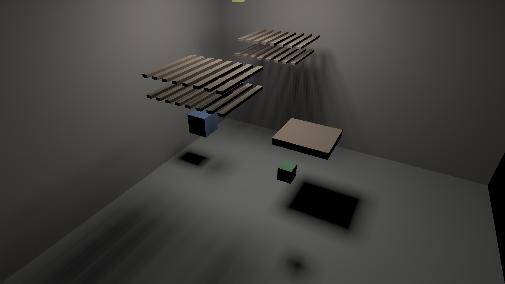

# M2 gate 5: moving objects with exact soft shadows on the GPU

Date: 2026-10-24. Gate 4 cached direct light on static surfaces in world-space
texels. This gate adds the paradigm's second rule, "apply what changed exactly
where that is cheap": when objects move, re-bake only the texels whose cones
they can reach. It is a port of 3D gate 4 (exact incremental updates, 14.9×
faster on the CPU) to the GPU lighting cache.

Pass criterion, fixed before the first run: (1) after every frame's update,
every texel equals a full re-bake with the movers at their new positions,
within 1e-5 of the peak texel irradiance; (2) the mean frame (mover upload,
hierarchy rebuild, block marking, re-bake, and the 1920×1080 cached render,
each submitted and waited on) takes at most 16.7 ms on the M4 Air, over 120
frames.

**Verdict: PASS on the first run.** Every texel matched a full re-bake exactly
(maximum difference 0) on all 120 frames, and the mean frame took 9.85 ms at
1080p.

## Method

- **Texel blocks.** Lightmap texels are stored in 8×8 blocks of 64 consecutive
  entries, so a block is one GPU workgroup.
- **Cone volumes.** Each block gets up to 16 planes of a convex volume holding
  every one of its texels' cones: the hull of the block and the light (every
  plane through three of the points that has all of them on one side), pushed
  out by 1e-3. Blocks whose texels all face away from the light get a plane
  that excludes everything, since they never receive direct light. This is
  computed once.
- **Movers.** Moving meshes have no texels. Camera hits on them get a mask cone
  per pixel, as in gate 3.
- **Each frame:**
  1. Upload the moved triangles and rebuild the mesh hierarchy (40 meshes, on
     the CPU).
  2. A marking pass tests each block's planes against each mover's swept bounds
     (old ∪ new) and appends the blocks no plane separates to a list, counting
     them with an atomic that is also the indirect dispatch size.
  3. A re-bake pass runs one workgroup per listed block.
  4. The cached render runs as in gate 4.
- **Why it is exact.** A texel's result depends on a mesh only through
  triangles inside its cone, and coverage combines across meshes by max, which
  does not depend on order. So a texel whose cone volume no mover reached, now
  or before, keeps exactly the value a full re-bake would give.

## Results

Render scene (37 static box meshes) plus the three boxes from 3D gate 4: one
sliding under the fences, one orbiting just below the light, one bobbing.
821,376 texels in 12,834 blocks; Apple M4 (MacBook Air). Reproduce with
`cargo run --release -p room3d --bin m2_gate5`.

| Per frame, mean over 120 frames | Time |
|---|---|
| Update (upload, hierarchy, marking, re-bake) | 4.17 ms |
| Cached render, 1920×1080 | 5.68 ms |
| **Frame** | **9.85 ms** (12.02 ms worst) |
| Full re-bake instead, for comparison (GPU time only) | 21.90 ms |

| | |
|---|---|
| Blocks re-baked per frame | 6.1% |
| Max difference from a full re-bake | 0.0 |

The real-time viewer now has the moving boxes (P pauses them). It runs at
about 7.5 ms per frame at 2560×1440, up from 3.6 ms with nothing moving.

## What this shows

- Moving objects cast exact soft shadows from an area light in real time on a
  fanless laptop GPU, with no denoiser, temporal accumulation or shadow-map
  filtering. The image is the same as baking the whole scene again every frame.
- Incremental updates are what make this possible. A full re-bake every frame
  would cost about 21.9 ms plus 5.7 ms for the render, which misses 60 fps. The
  update re-bakes 6.1% of blocks and takes 4.2 ms, about 5× less.
- The update cost depends on how much of the scene the movers can reach, not
  on how much the camera sees. A box near the light reaches a lot: its soft
  shadow is large.

## Caveats

- **Measurement includes CPU waits.** The update time includes the CPU work and
  two submit-and-wait round trips. In the viewer, which does not wait, the
  update adds about 3.9 ms per frame at 1440p.
- **Re-baked texels redo everything.** They traverse the hierarchy and
  rasterize static triangles again. 3D gate 4 also cached each texel's static
  coverage, so a re-bake only adds the movers. That would cut the re-bake cost
  further, at about 256 bytes per lit texel (around 120 MB here).
- **The marking test is conservative.** It uses each mover's swept bounding box
  and the hull's face planes only (no edge-edge separating axes), so it re-bakes
  some blocks that did not change.
- **Movers are shaded per pixel.** They are cheap here because they are small
  on screen; a large mover close to the camera costs per-pixel cones on every
  pixel it covers.
- **Static scene limits.** The light is static and the lighting is direct only.
  Moving the light would invalidate most blocks; 2D gate 7 is the relevant
  experiment.
- **Development profiling.** The method was profiled in the viewer during
  development, before this gate's first run. The criterion was written down
  before any of that code was built.
