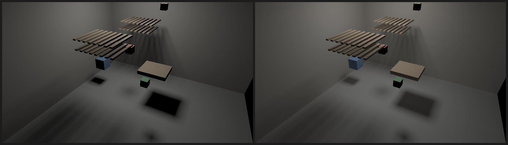
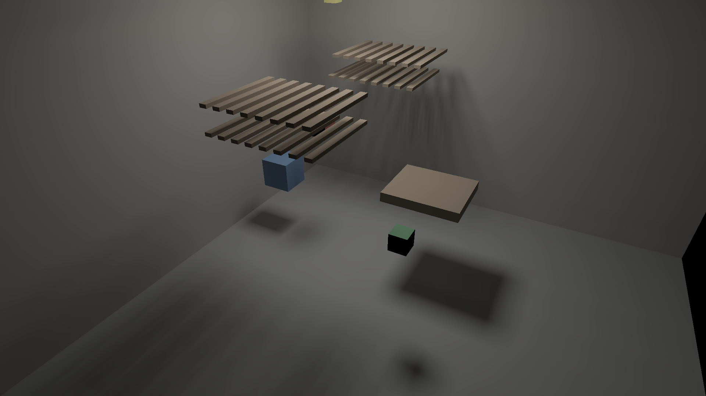

# M2 gate 6: one bounce of indirect light from cone G-buffers on the GPU

Date: 2026-10-24. Until now, lighting was direct only, so shadows were black.
This gate adds one bounce of indirect light, using the 2D mechanism that passed
gate 6b (cone G-buffers): cache per direction what static geometry is seen, and
re-gather only the radiance, which changes.

Pass criterion, fixed before the first run:

1. **Exact incremental updates.** On every one of 120 frames, each probe's
   indirect irradiance equals a from-scratch gather that traces every bin
   through the current scene (movers in place, black), within 1e-5 of the peak
   probe value.
2. **Accuracy.** On the last frame, the probes' indirect irradiance is within 5%
   relative RMSE (sqrt(Σ|a − b|² / Σ|b|²) over RGB, over probes the reference
   marks valid) of a 64×64-per-face reference gather (16× the directions) with
   the same direct cache and movers.
3. **Speed.** The mean frame (gate 5's update plus the gather, and the
   1920×1080 render with direct and indirect light, each submitted and waited
   on) takes at most 16.7 ms on the M4 Air.

**Verdict: attempt 1 failed (1); attempt 2 passed.** The gather matches a
from-scratch trace exactly on every frame, is 3.6% off a reference with 16× the
directions, and the whole frame (moving boxes, exact soft shadows, one bounce)
takes 11.66 ms at 1080p.

## Method

- **Probes.** About 0.04 units apart on every static face: 12,834 probes, row
  major per face, nudged off the surface like texels.
- **Cone G-buffers.** Each probe has a hemicube of direction bins: 16×16 on the
  top face and 16×8 on each side face, 768 bins in all.
  - Each bin stores the nearest static triangle along its center direction and
    the distance to it, or "no hit", with a flag when the triangle's back faces
    the probe.
  - The G-buffers are built once, through a hierarchy of the static meshes:
    79 MB in total.
  - Bin weights are their exact projected solid angles (Lambert's formula);
    they sum to π.
- **The gather, each frame.** One workgroup per probe. For each bin:
  1. Composite the moving meshes by depth: a slab test against each mover's
     bounds, then its triangles. Movers are black occluders, as in 2D gate 6b.
  2. If no mover is nearer, take the bin's radiance: the hit surface's albedo
     times its direct irradiance from the lightmap (bilinear), over π.
  3. Sum with the bin's weight; the sum order is fixed.

  The lightmap is the one gate 5 keeps exact as boxes move, so indirect light
  follows moving shadows with no extra tracking.
- **Leaks.** A probe whose bins see more than 10% back faces (weighted) sits
  inside geometry, for example floor probes under a wall. It is marked invalid,
  and lookups renormalize over the valid neighbors. 323 probes are invalid.
- **The render.** Static surfaces add the bilinearly interpolated probe
  irradiance (RGB, so bounce light carries color) to the direct cache lookup.

## Results (attempt 2)

Render scene (37 static box meshes) plus gate 5's three moving boxes; 120
frames; Apple M4 (MacBook Air). Reproduce with
`cargo run --release -p room3d --bin m2_gate6`; the side-by-side above is
`cargo run --release -p room3d --bin render_indirect`.

| Per frame, mean over 120 frames | Time |
|---|---|
| Update: movers, hierarchy, block marking, re-bake, gather | 5.94 ms |
| ↳ of which the gather (12,834 probes × 768 bins) | 2.41 ms |
| Render at 1920×1080, direct and indirect | 5.71 ms |
| **Frame** | **11.66 ms** (13.86 ms worst) |

| | |
|---|---|
| Max difference from a from-scratch trace | 0.0 (all frames) |
| Relative RMSE against 64×64 bins per face | 3.60% |
| Setup: upload, G-buffer build, first gather | 53.6 ms, once |

## Attempt 1 and the bug it found

Attempt 1 met criteria 2 and 3 (3.60%, 12.49 ms) but failed criterion 1. 425
of 1.54 million probe-frames differed from the from-scratch trace, by up to
1.7e-3 of peak.

A per-bin dump of mismatched probes showed the cause. It is not motion: three
probes already disagreed on frame 0, before anything moved.

- Every mismatch was a ray grazing a box face. Box meshes lie exactly on their
  bounding boxes, so a ray can pass the exact triangle test and fail the
  hierarchy's box (slab) test by a rounding error.
- Whether that happens depends on how meshes are grouped into nodes. The cached
  path traces a hierarchy of static meshes; the from-scratch path traces a
  hierarchy of all meshes. So the same ray could hit a slat in one and miss it
  in the other.
- Example: a floor probe's bin hit a slat's side at distance 0.80 in the cached
  path, but reached the wall at 1.36 in the from-scratch path.

**The fix:** hierarchy boxes and mover bounds are now padded by 1e-5 of the
scene's scale (at least 1e-5). Box tests then never reject a triangle the exact
test would hit, so the nearest hit does not depend on how boxes are grouped.
The same diagnostic then showed zero mismatches on every frame.

The padding is shared code, so gates 2 to 5 were rerun:

- Gates 2 and 3 have unchanged verdicts and identical outputs. Gate 2's
  hierarchy is now 1.9× faster than brute force (it was 1.6×), still under 3×.
- Gate 4: 5.72 ms, 0.58%.
- Gate 5: exact, 9.91 ms.

## What this shows

- **Indirect light at frame rate with exact updates.** One bounce of
  color-carrying indirect light, over moving objects and their exact soft
  shadows, in 11.7 ms per 1080p frame on a fanless laptop GPU. There is no
  temporal accumulation, denoising or ray budget: the result each frame is the
  same as tracing every bin from scratch (criterion 1).
- **The paradigm's split holds at the second bounce.** What cannot change (which
  static surface each direction sees) is cached once. What changes (the
  radiance of those surfaces, and movers in front of them) is applied exactly
  every frame. Tracing every bin from scratch is what a renderer without the
  cache would do; here it is only the verification path.
- **Accuracy is set by direction count, not noise.** 768 fixed directions per
  probe are 3.6% off 12,288 directions, and the error is stable from frame to
  frame (no flicker), because the bins are fixed.

## Caveats

- **Movers.** They receive no indirect light (their shadowed sides stay black,
  visible on the green box above), and they reflect none: they are black
  occluders. Fixes: let movers sample the probe field, and shade mover hits in
  the gather.
- **One bounce only.** Feeding the gathered indirect back into bin radiance
  would add more bounces at the gather's cost each.
- **Probe resolution.** At about 0.04 units, indirect light blurs near contacts
  and corners. Invalid-probe handling avoids light leaking from inside walls,
  but not all leaks (thin walls with probes on both sides).
- **Memory.** 79 MB of G-buffers at 8 bytes per bin. 16-bit distances and face
  ids would halve it.
- **Static geometry and light.** As in gate 5, the light is static. Moving
  static geometry would need its G-buffer entries rebuilt.
- **Development profiling.** The viewer was profiled with indirect light during
  development, before the first gate run. The criterion was written down before
  any of the code was built.
