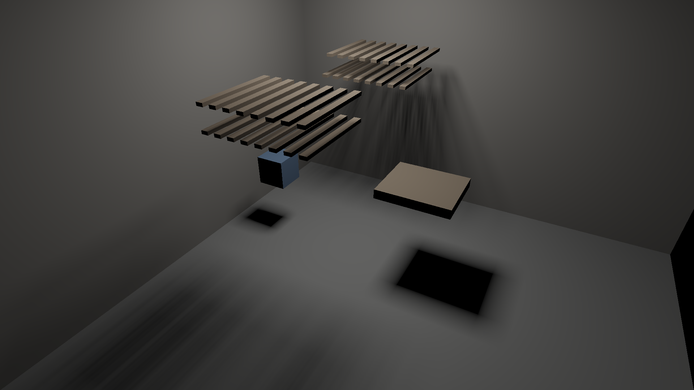

# First GPU render

Date: 2026-10-24 (overnight run). Not a gate: a first data point toward M2's
1080p frame-time target, and a check that the GPU kernel reproduces the CPU
image.

One WGSL kernel per pixel: cast the camera ray to the nearest triangle, then
take a mask cone from the hit toward the area light and shade it diffusely.
Brute force throughout (every pixel tests all 444 triangles for its ray and
again for its cone; no hierarchy on the GPU yet). Reproduce with
`cargo run --release -p room3d --bin render_gpu`.

| Resolution | Apple M4 (MacBook Air) |
|---|---|
| 480×360 | 18.3 ms |
| 960×540 | 49.2 ms |
| 1920×1080 | 188.7 ms |

Check against the CPU render at 480×360: max difference 1.3e-5 of peak
brightness; 0 of 172,800 pixels over 1e-3.

## Honest reading

- Not real time yet: about 5 fps at 1080p on a fanless laptop GPU. Both ray
  casting and cone culling test every triangle; hierarchy traversal and
  tile-shared work on the GPU should take most of that away. That is M2's work.
- Soft shadows are clean and noise-free with one cone per pixel; there is no
  denoiser and no temporal accumulation.
- Shadows are black because there is no indirect light yet.
- Primary visibility is one ray per pixel, so geometry edges alias slightly; the
  paradigm's coverage-mask anti-aliasing for primary visibility is not built yet.
