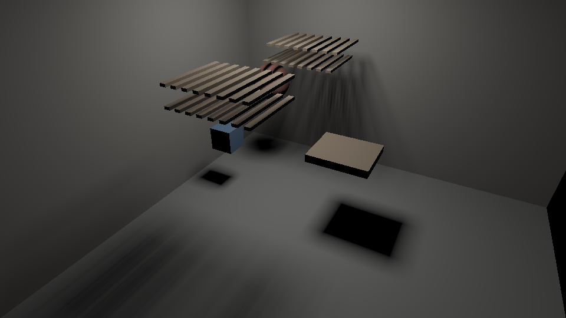

# M3 gate 1: per-mesh triangle hierarchies on the GPU

Date: 2026-10-24. The GPU hierarchy used to stop at meshes: a ray or cone that
reached a mesh tested every one of its triangles. That is fine for 12-triangle
boxes and hopeless for real meshes. Each mesh now gets its own triangle
hierarchy, a second level under the mesh hierarchy.

Pass criterion, fixed before the first run (committed in aa17f0c before any
implementation): on the M2 render scene plus a 200×100 sphere (about 40,000
triangles), with per-pixel mask cones at 960×540 and the mesh hierarchy on:

1. With per-mesh triangle hierarchies, every pixel is within 1e-5 of peak
   brightness of the render that tests each touched mesh's triangles one by one.
2. It is at least 10× faster (best of 5, warm).

**Verdict: FAIL on (2).** Output is identical (max difference 5.0e-7 of peak),
but only 3.9× faster.

## Method

- **Building the hierarchies.** Each mesh's triangles get a median-split
  hierarchy, at most 8 triangles per leaf. Boxes are padded as in M2 gate 6.
  The tree's shape depends only on the triangle count, so a moved mesh's
  hierarchy is rebuilt in place.
- **Traversal.** Rays and cones share one 48-entry stack. The mesh hierarchy's
  pending entries stay at the bottom; the current mesh's triangle hierarchy is
  walked above them.
- **Cones.** A cone's per-mesh accumulator is unchanged: coverage is still
  summed within a mesh and combined by max across meshes.
- **Ray ties.** Ties now go to the lower mesh, then the lower triangle, so the
  nearest hit does not depend on traversal order.
- **Leaf size.** Leaves of 8 triangles were chosen while developing, before
  this gate's first run, by timing the M2 gates. With leaves of 4, the cone
  paths of the box scenes got slower: a box test costs about three triangle
  tests.

## Results

Apple M4 (MacBook Air, on battery). Reproduce with
`cargo run --release -p room3d --bin m3_gate1`.

| Per-pixel mask cones, 960×540 | Time |
|---|---|
| Mesh hierarchy only | 1131.3 ms |
| With per-mesh triangle hierarchies | 292.0 ms (3.9×) |

## Why it failed

A diagnostic varied the sphere's tessellation, with the triangle hierarchies on:

| Sphere triangles | Frame |
|---|---|
| none | 26.5 ms |
| 360 | 29.8 ms |
| 3,480 | 58.1 ms |
| 39,600 | 278.7 ms |

The extra cost grows roughly in proportion to the sphere's triangles. That
points at work the hierarchy cannot remove: cones whose window contains the
sphere really do contain about half of its triangles (the ones facing the
apex), and each is clipped and rasterized into the cone's 8×8 bins. The
hierarchy removed the culling cost: 1131 → 292 ms is the triangles outside the
cones.

That is what DESIGN §3.4 (prefiltered hierarchy) is for: a cone should stop
descending once a node is smaller than a bin and use the node's prefiltered
coverage, so cost follows the cone's resolution, not the mesh's. Until then:

- Dense meshes are expensive inside cones: in the bake, in re-bakes near
  movers, and in per-pixel cones for movers.
- Rays are not affected: camera rays and probe G-buffer rays traverse to a
  single triangle.
- The general-mesh showcase (M3 gates 2 and 3) keeps tessellation moderate,
  and its timings show the effect.

## What this shows

- Triangle hierarchies give identical output and remove per-triangle culling
  cost. That is necessary for real meshes, but not sufficient for mask cones.
- Mask cone cost is set by the triangles inside the cone, which grows with
  tessellation. That is the case for the prefiltered hierarchy (DESIGN §3.4),
  now with a measured cost curve.
