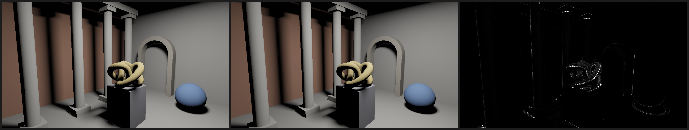

# M3 gate 2: general meshes in the lighting cache

Date: 2026-10-24. Until now the lighting cache put texels on box faces only.
Any mesh now works if it comes with a chart layout and shading normals
(`continuum::mesh::Surface`).

- **Charts.** Every triangle lies in a rectangular chart, and its vertices have
  coordinates in that chart. Box faces and planar quads pair into one chart
  each, a parametric surface (cylinder, sphere, torus knot, arch) gets one
  smooth chart, and any other triangle gets a chart of its own.
- **Texels.** They are placed through those coordinates: a texel whose center
  lands in a triangle takes that point and the interpolated normal, and one
  within 1.5 texels of a triangle takes the nearest point on it, so bilinear
  lookups never read empty texels.
- **Lookups.** A camera hit finds its chart coordinates from its triangle's
  barycentric coordinates.

Pass criterion, fixed before the first run (committed in aa17f0c before any
implementation): on the showcase (static meshes only) at 1920×1080 from the
first key of its camera path,

1. The cached render (direct light only) is within 2% relative RMSE of the
   per-pixel mask-cone render of the same frame, which shades with the same
   interpolated normals.
2. The cached render takes at most 16.7 ms (best of 5, warm).

**Verdict: PASS.** 1.61% RMSE, 4.99 ms.

## The showcase scene

The scene is `experiments/room3d/src/showcase.rs`. Everything is procedural,
so it needs no assets and can be exported to other renderers.

- **The room.** 5 × 4 × 3 m: a terracotta back wall, a teal left wall,
  off-white walls elsewhere, and a ceiling.
- **The light.** One 0.6 × 0.45 m skylight panel just under the ceiling,
  emitting downward. Lights can now be one-sided: they emit only toward
  `edge_u × edge_v`, and camera rays see their front.
- **The objects.**
  - A colonnade of four 32-sided columns on plinths, under a beam.
  - A (2, 3) torus-knot sculpture (3,840 triangles) resting on a pedestal.
  - Two spheres on the floor.
  - A sandstone arch on two pillars.
- **Moving objects (removed for this gate).** A bouncing ball and a spinning
  cube orbiting the sculpture.

29 static meshes, 7,324 triangles. Lightmap: 818,688 texel slots, 789,484 of
them on surfaces, 1.25 cm apart.

## Results

Apple M4 (MacBook Air, on battery). Reproduce with
`cargo run --release -p room3d --bin m3_gate2`.

| | |
|---|---|
| Chart layout (CPU) | 24 ms |
| Bake (one mask cone per texel) | 90 ms |
| Cached render, 1920×1080 | **4.99 ms** |
| Per-pixel mask cones, 1920×1080 | 158.4 ms |
| Relative RMSE (RMSE / mean, linear RGB) | **1.61%** |

The difference image shows where the cache differs from per-pixel cones:

- **The torus knot.** Its tube is 13 cm around with 12 sides, so a texel
  spans part of a facet, and bilinear interpolation across facets differs from
  a cone at the exact pixel.
- **Silhouettes and contact rings** (the sphere's floor contact, the arch's
  base). Texels interpolate across sharp changes in visibility.

## Found while building this

- **Watertight rays.** A pixel on a column was dark: its ray passed exactly
  through the edge shared by two of the column's facets (barycentric
  coordinate 0.00000). In f32, both triangle tests rejected it, so the ray hit
  the column's shadow on the wall behind. The GPU ray-triangle test now allows
  1e-5 of slack on its edge tests, so shared edges are watertight. The CPU
  test is unchanged.
- **Static coverage cache.** Gate 1 showed that dense meshes inside cones are
  expensive, so each texel that can receive direct light now caches the
  coverage of static meshes in its cone. A re-bake then adds only the moving
  meshes; coverage combines by max, so this stays exact. M2 gate 5's update
  went from 4.56 to 2.06 ms, still bit-exact. Cost: 16 KB per lit block
  (256 bytes per texel), for blocks that can receive direct light.
- **Probes on moving objects.** Each moving mesh's charts get probes that
  follow it and are traced from scratch every gather, about 120 in the
  showcase. Moving objects now get bounce light instead of black shadowed
  sides. They are still black occluders in other probes' gathers.

## Caveats

- Lambertian materials only: no textures, no specular.
- Charts come from the procedural generators. Imported meshes fall back to a
  chart per triangle, or per planar quad; real assets need automatic
  unwrapping (for example xatlas).
- Dense meshes inside cones still cost per-triangle rasterization in the bake
  and in per-pixel cones (gate 1). The showcase keeps tessellation moderate.
