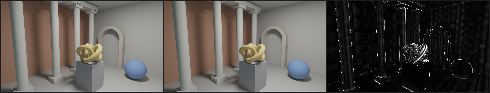

# M3 gate 3: the showcase in real time, against Cycles

Date: 2026-10-24. This gate runs the showcase scene (M3 gate 2) with its two
moving objects. Direct light is cached in texels and re-baked exactly where
movers reach (M2 gate 5, now with a static coverage cache). One bounce of
indirect light comes from probe G-buffers (M2 gate 6), and moving objects now
carry their own probes. For the first time, the result is measured against an
independent path tracer: Blender's Cycles.

Pass criterion, fixed before the first run (committed in aa17f0c before any
implementation):

1. **Exact incremental updates.** On every frame of the camera path, lightmap
   texels equal a full re-bake and probes equal a from-scratch trace, within
   1e-5 of peak.
2. **Speed.** The mean frame (movers, re-bake, gather, and the 1920×1080
   render with direct and indirect light, each submitted and waited on) over
   the 300-frame camera path takes at most 16.7 ms, warm, on the M4 Air. A
   sustained number (after 60 s of continuous rendering) is reported.
3. **Quality.** The static showcase frame (movers removed) at 960×540 is
   within 5% relative RMSE (linear RGB) of a Cycles render of the same scene:
   Lambertian albedos, the same one-sided rectangular emitter, direct light
   plus one diffuse bounce, pixel-center sampling, 4096 samples per pixel. The
   reference's own noise is reported.

**Verdict: FAIL on (2), narrowly.** Exact on every frame (1) and 3.80% from
Cycles (3), but the mean frame took 17.76 ms against 16.7. As the project's
rules require, this is recorded as a fail: no parameters were tuned and the
gate was not rerun.

## Results

Apple M4 (MacBook Air, on battery). 31 meshes (29 static, 7,324 triangles;
plus a 528-triangle ball and a 12-triangle cube). 818,688 texel slots and
12,912 probes, 120 of them on the moving objects. Reproduce with
`cargo run --release -p room3d --bin m3_gate3` (it needs Blender 4.2 or later;
set `BLENDER` if it is not in `/Applications`).

| Criterion | Result |
|---|---|
| 1. Texels vs a full re-bake, 300 frames | max difference **0.0** |
| 1. Probes vs a from-scratch trace, 300 frames | max difference **0.0** |
| 2. Mean frame at 1920×1080 | **17.76 ms** (10.84 update + 6.91 render), worst 23.03 ms |
| 2. Sustained, after 60 s | 18.78 ms |
| 3. Relative RMSE against Cycles | **3.80%** |

Other numbers:

- Bake: 95 ms. Static coverage cache, G-buffers and first gather: 153 ms.
- Blocks re-baked per frame: 4.9%.
- The Cycles reference took 77 s on the M4 GPU (Metal).

### Error against Cycles, by term

| | Relative RMSE |
|---|---|
| Full image (direct + one bounce) | 3.80% |
| Direct light only (Cycles with 0 bounces) | 4.93% of the direct image's mean |
| Indirect only (full minus direct) | 2.02% of the full image's mean (5.5% of the indirect mean) |
| Cycles' own noise at 4096 spp | 0.31% |

The difference image shows where the error is:

- **The torus knot** has the largest error. Its tube has only 12 sides, so
  shading with interpolated normals differs from Cycles' handling of normals
  near the shadow terminator, and texels interpolate across its curved facets.
- **Silhouette edges** (columns, arch, sphere): a pixel centered on an edge
  lands on different sides in the two renderers.
- **Faint low-frequency blotches on the walls** come from probe interpolation
  (probes are 10 cm apart) plus Cycles noise.

### Validating the Cycles pipeline

Before the gate, `cargo run --release -p room3d --bin cycles_calibration`
compared the two renderers on a scene with a known answer: an open floor under
the same skylight, plus a camera that sees the light.

| Check | Continuum | Cycles |
|---|---|---|
| Mean floor brightness | 0.28264 | 0.28223 (0.15% lower) |
| Light seen directly | 70.0 | 69.6 (edge pixels partly covered) |

Every pixel was classified the same way as light or not. The 1.39% floor RMSE
is Cycles' noise at 1024 spp. So the units, camera, one-sided light and
Lambertian materials match.

## Where the frame time goes

Measured after the gate (the verdict stands), over the same path:

| Part | Time |
|---|---|
| Probe gather (12,912 probes × 768 bins) | ~6.4 ms |
| Uploads, hierarchy rebuild, marking, re-bake, waits | ~4.3 ms |
| Render at 1920×1080 | ~6.9 ms |

Compared with M2:

- **The gather is about 2.5× slower** than in the box room. Each bin now finds
  its hit's chart coordinates from the triangle (three vertices, three
  coordinates). Probes on moving objects trace all their bins from scratch,
  which probably leaves a slow tail at the end of the dispatch.
- **The render** is 5.0 ms static (gate 2). The extra comes from moving
  objects' pixels running per-pixel mask cones, which contain the dense knot.

Concrete fixes for a next attempt, which would need a new criterion fixed
before it runs:

1. Store each bin's chart coordinates in the G-buffer at build time. Static
   hits never move, so the gather becomes a pure lookup.
2. Re-gather only probes that see a changed block, by keeping each probe's
   list of blocks its bins hit. 2D gate 6b did this ("re-sum only cones that
   show the changed patch").
3. Trace moving objects' probes in their own dispatch, one invocation per bin.
4. Give moving objects a per-frame texel set instead of per-pixel cones, so
   their cost follows their texels, not their screen size.

## What this shows

- **A measured quality number.** Against an independent path tracer, the
  real-time renderer is 3.8% off on a scene with curved meshes, color bleeding
  and soft shadows, at under 1/4000 of the time. Most of that error is the
  12-sided knot and silhouette pixels, and the two images are hard to tell
  apart.
- **Exactness holds under general motion.** Texels and probes matched
  recomputing from scratch bit for bit on every frame, with a spinning cube
  and a bouncing ball, including probes that ride on the moving objects.
- **Speed is close, not there.** 17.8 ms against 16.7, on battery, on a
  fanless laptop GPU at 1080p. The gather and the moving objects' per-pixel
  cones are the identified costs.

## Caveats

- Lambertian materials, one light, one bounce: Cycles was configured to
  compute the same thing (direct light plus one diffuse bounce). That checks
  correctness, not how close this is to a fully path-traced image (more
  bounces, specular).
- Moving objects reflect no light in other probes' gathers; they are black
  occluders. The quality criterion used the static frame.
- FLIP was not computed. DESIGN rule 4 asks for it; relative RMSE is reported
  instead.
- Timings are on battery power. The benchmark protocol asks for a plugged-in
  machine.
