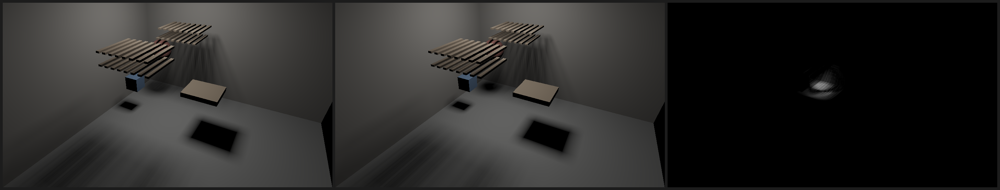

# M4 gate 1: prefiltered cones (scale of detail)

Date: 2026-10-24. M3 gate 1 found that a mask cone's cost grows with the
triangles really inside it: a triangle hierarchy can cull triangles outside a
cone, not the ones inside. This is what DESIGN §3.4 (prefiltered hierarchy) is
for, and the first piece of making detail scale.

Pass criterion, fixed before the first run (committed in 53d99d2 before any
implementation): on the M2 render scene plus the sphere of M3 gate 1 at four
tessellations (about 40k, 160k, 640k and 2.56M triangles), with per-pixel mask
cones at 960×540:

1. At every tessellation, the prefiltered render is within 1% relative RMSE
   (RMSE over the mean, linear RGB) of the exact render (no prefiltering).
2. The prefiltered render at 2.56M triangles takes at most 1.5× the
   prefiltered render at 40k triangles (best of 5, warm).

**Verdict: PASS.** About 0.55% from exact at every tessellation, and the cost
did not grow: at 2.56M triangles the frame took 0.76× the time at 40k. Exact
cones took 13.7 s there; prefiltered took 86 ms.

## Method

- **What each node stores.** Each node of a mesh's triangle hierarchy stores 27
  samples (26 used): the projected area of its front-facing triangles seen
  from each direction `(i, j, k)`, with `i, j, k` in `{-1, 0, 1}`. A
  triangle's contribution is its area-weighted normal dotted with the
  direction, clamped at zero. The samples add up over children, so the whole
  hierarchy costs O(nodes × 26) to build.
- **The splat.** While walking a mesh's hierarchy, a cone tests each node. If
  the node's box lies between the cone's near and far planes and projects to
  at most one bin (the threshold), the cone stops descending and splats the
  node:
  - It takes the box's projected silhouette: the clockwise convex hull of its
    8 projected corners, the same winding as front-facing triangles.
  - It weights it by `α = F(v) / S(v)`, where `F` is the front-facing
    projected area toward the apex (interpolated bilinearly on the cube face
    the direction points through) and `S` is the box's projected area.
  - It rasterizes the result into the mesh's accumulator with the same exact
    rasterizer as triangles.
- **Why splats and triangles mix correctly.** Splats add to the mesh's
  triangles as front-facing triangles do (summed within a mesh, combined by
  max across meshes). Counting front faces only means the front and back of a
  closed surface are not counted twice.
- **The threshold** is a kernel setting (`set_prefilter`). The default is 0:
  exact, as before. Earlier gates are unchanged.

## Results

Apple M4 (MacBook Air, on battery). Reproduce with
`cargo run --release -p room3d --bin m4_gate1`.

| Sphere triangles | Exact cones | Prefiltered (best of 5) | Error vs exact |
|---|---|---|---|
| 39,600 | 307.2 ms | 113.04 ms | 0.544% |
| 159,200 | 939.2 ms | 92.50 ms | 0.545% |
| 638,400 | 3,606.1 ms | 85.28 ms | 0.545% |
| 2,556,800 | 13,749.8 ms | **85.73 ms** | 0.546% |

Without the sphere, prefiltered: 31.39 ms.

## What this shows

- **Cost now follows the cone's resolution, not the mesh's.** From 40k to
  2.56M triangles the prefiltered frame got slightly faster: finer meshes have
  tighter node boxes, so splats start earlier. Exact cones grew 45×.
- **The error does not grow with detail** (about 0.55%). It is concentrated in
  the sphere's shadow: a splat spreads a node's coverage evenly over its
  box's footprint, so where coverage sits inside a bin is approximate.
- **A building block for scale.** Distant objects become single splats at
  their root node (gate 2).

## Caveats

- **Overhead on scenes with nothing to splat.** The scene without the sphere
  takes 31.4 ms prefiltered against about 26.5 ms exact (M3 gate 1's
  diagnostic): every node visited is projected before deciding. A cheaper
  first test would remove most of that.
- **The sphere still costs about 54 ms at this resolution.** Its nodes are
  splatted, but many cones contain it at 4–8 bins across.
- **Approximate, and not bounded.** Unlike the paradigm's exact paths, a splat
  carries no error bound. A conservative bound (coverage between 0 and the
  box's footprint) would be loose; the ledger (§3.1) could use it.
- **Within one mesh only.** Splats happen inside meshes' triangle
  hierarchies. Many separate meshes in one bin still combine by max (DESIGN
  §8, "bins shared by separate meshes").
