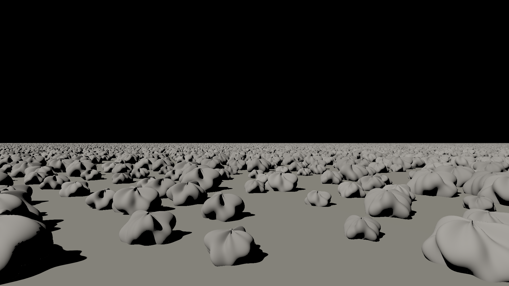

# M4 gate 2: ten billion instanced triangles in a large world

Date: 2026-10-24. This gate tests the other two axes of scale: how much there
is (instancing) and how big the world is (large-world coordinates).

- **Instancing.** Objects reference shared geometry with a rotation, a uniform
  scale and an f64 position. The mesh hierarchy became an object hierarchy with
  world-space bounds.
- **Object space.** On entering an object, rays and cones move into its space:
  a ray keeps its parameter, so distances stay world distances, and a cone
  keeps its window and bins. The triangle hierarchy and prefiltered splats
  (gate 1) run there unchanged.
- **Rebasing.** Positions are uploaded relative to a render origin near the
  camera, snapped to a 256 m grid.

Pass criterion, fixed before the first run (committed in 53d99d2 before any
implementation): a ground plane with a field of copies of one 9,800-triangle
procedural boulder on a jittered 2 m grid, lit by a sun-sized (0.5°) one-sided
light, with per-pixel mask cones at 1920×1080:

1. **Correctness.** With 64 instances and exact cones, the instanced render
   matches the same scene with every instance flattened into world space:
   relative RMSE at most 0.1%, and at least 99.9% of pixels within 1e-4 of
   peak.
2. **Scale.** With 1,000,000 instances (about 10^10 triangles) the frame takes
   at most 2× the frame with 1,000 instances (about 10^7), same camera.
3. **Large world.** The million-instance field moved 64 km from the world
   origin renders within 0.1% relative RMSE of the field at the origin.

**Verdict: FAIL on (1) and (2); (3) passed.**

## Results

Apple M4 (MacBook Air, on battery). Reproduce with
`cargo run --release -p room3d --bin m4_gate2`.

| Criterion | Result | Target |
|---|---|---|
| 1. Instanced vs flattened, RMSE | 0.22% | ≤ 0.1% |
| 1. Pixels within 1e-4 of peak | 99.868% | ≥ 99.9% |
| 2. 1,000,000 vs 1,000 boulders | 237.9 / 78.3 ms = **3.04×** | ≤ 2× |
| 3. Field 64 km out, rebased | **0.0000%** | ≤ 0.1% |
| 3. Same, without rebasing (contrast) | 5.21% | — |

The million-boulder field is 9,999,860,002 triangles in **152 MB** of GPU
memory: 1.8 MB of geometry and hierarchy, the rest per-instance transforms,
the object hierarchy, and albedos.

## Why (1) failed

A diagnostic counted the pixels outside the tolerance: 2,738 (0.13%). Only 2
of them differ by more than 5% of peak. Most are isolated speckles on boulder
surfaces, where nearby facets shadow each other at the sun's grazing angle,
plus a few lines along shadow edges.

That points at the flattened reference, not at instancing:

- **The flattened scene** stores each boulder's 5 mm triangles at world
  positions about 34 m from the render origin. In f32 that resolves about
  4 µm, roughly 1e-3 of a triangle edge, which is enough to shift tiny
  self-shadowing coverage.
- **The instanced path** evaluates triangles in object space (about 0.5 m from
  the boulder's own origin), which is about 100× more precise.

So instancing is the more accurate of the two. The criterion assumed the two
would agree to near float rounding, and was stricter than world-space f32
geometry allows. As the project rules require, it stands as a fail and was not
rerun.

## Why (2) failed

**Correction (M4 gate 6):** the diagnostic below was wrong. Its "sun turned
away" light had both edges reversed, which leaves the emitting side unchanged,
so the "rays only" column measured full frames. Measured correctly, sun cones
dominate (at 720p standing: rays 7.9 ms, cones 41 ms; from 150 m up: rays 21.5
ms, cones 231 ms). See `m4-gate6.md`. The original text follows for the record.

Measured after the gate by running the same frames with the sun turned away,
so that no cones run:

| Boulders | Full frame | Camera rays only | Cones |
|---|---|---|---|
| 1,000 | 79.3 ms | 78.8 ms | about 0.5 ms |
| 1,000,000 | 236.0 ms | 230.9 ms | about 5 ms |

- **Camera rays, not cones, set the cost.** Cones toward a 0.5° sun are narrow
  and nearly free, even through a million instances, thanks to prefiltering
  and the object hierarchy.
- **The rays scale poorly.** Rays near the horizon pass over thousands of
  boulder boxes, and the hierarchy is walked in a fixed child order rather
  than nearest first, so a ray often descends into far boulders before
  finding the near one that ends it.
- **Next fixes:**
  - Nearest-first traversal.
  - A surface-area heuristic hierarchy.
  - For the far field, the paradigm's own answer: primary visibility through
    pixel-footprint cones that stop at nodes smaller than a pixel. That is
    DESIGN §3.2's "mask coverage anti-aliasing", the same prefiltering as
    gate 1 applied to the camera.

## What this shows

- **Ten billion triangles render on a fanless laptop GPU from 152 MB.** The
  frame took 238 ms at 1080p with per-pixel direct sun shadows and no caches.
  That is a scale result, not a real-time one.
- **Large worlds work by construction.** With f64 positions rebased near the
  camera, a field 64 km from the origin renders identically. Without
  rebasing, the same frame shows shadow acne (5.2% error), even though object
  space already hides most of the precision loss.
- **Object-space evaluation is also a precision win.** Instanced geometry is
  computed relative to its own origin, so detail far from the world origin
  stays exact.

## Found while building this

A receiver's own large supporting triangle (here the 2 km ground) could leak
spurious coverage. Its apex sits 0.1 mm above a plane that extends a
kilometer, and f32 clipping of that nearly coplanar triangle produced slivers,
visible as speckle on one half of the ground. A triangle facing the apex can
only block directions going into it, so it is now skipped when every corner
of the cone's window points away from its plane. That test is exact, not a
tolerance. On the M2 scene it changes nothing (texels, cached and per-pixel
renders bit-identical with and without it).

Rerunning the earlier gates turned up a second issue. M2 gate 4's metric had
moved from 0.58% to 0.70% since M3. An A/B test pinned it on the ray edge
tolerance added in M3 for watertight meshes:

- At a box's silhouette, a grazing camera ray could hit the back of the
  adjacent side face within the tolerance.
- Per-pixel shading flips the normal and lights that pixel, but the lighting
  cache, whose texels lie on front faces, returns the face's unlit texel.

Camera rays now ignore back faces. Meshes are closed, and the showcase's room
shell faces inward. Probe rays still see back faces, which they need to detect
probes inside geometry.

Reruns after both changes:

| Gate | Result |
|---|---|
| M2 gate 4 | 0.55% (better than either earlier number) |
| M2 gates 5 and 6 | bit-exact as before; gate 6 at 3.58% |
| M3 gate 2 | 1.61%, unchanged |

## Caveats

- **Primary visibility is one ray per pixel.** The far field aliases: boulders
  at 1–2 km are smaller than a pixel. That is the main visual reason for
  cone-based primary visibility.
- **No caches.** Lighting is per-pixel cones every frame (the brute-force
  path, M2 gate 3). A virtual lighting cache sized to the view, not to the
  world, is the planned next piece.
- **One light, no sky or bounce light,** so shadows are black.
